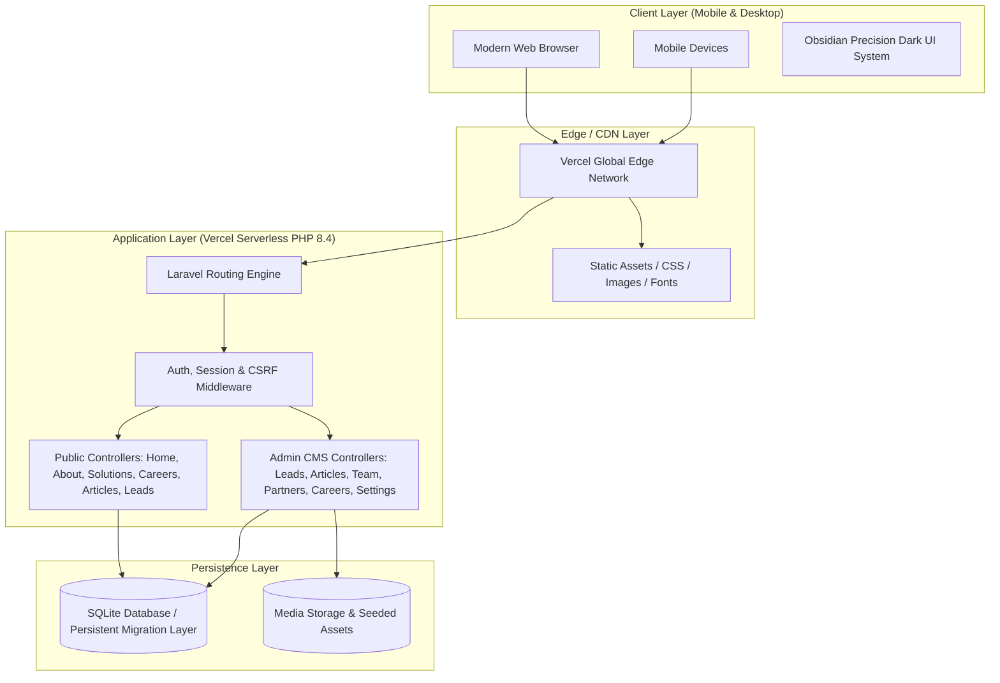
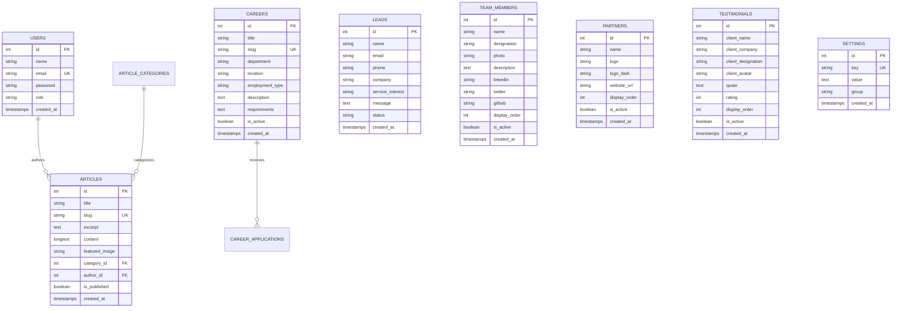

# 📘 Talisha Software — Master System Documentation

> **Official Technical & Architectural Documentation for Talisha Software Enterprise Web Platform**  
> **Production URL:** [https://talisha-software.vercel.app](https://talisha-software.vercel.app)  
> **Repository:** [https://github.com/Mrinmoypatratint/talisha-software.git](https://github.com/Mrinmoypatratint/talisha-software.git)  
> **Last Updated:** October 2026 | **Version:** 2.0.0 (Production Stable)

---

## 1. Executive Summary & Company Profile

**Talisha Software** is a next-generation engineering studio delivering sovereign Agentic AI solutions, enterprise software architectures, Web3/Blockchain protocols, and IoT transformations. The web platform serves as both a high-conversion digital storefront and a full-featured content and lead management system (CMS).

### Corporate Metadata
| Attribute | Official Specification |
|---|---|
| **Company Legal Name** | Talisha Software Private Limited |
| **Industry** | Agentic AI, Autonomous Workflows, Web3 & Enterprise Engineering |
| **Founders / Leadership** | Abir Ghosh (CEO), Pijush Pal (CTO), Mrinmoy Patra (Lead Architect) |
| **Primary Hubs** | Durgapur, Kolkata, Bengaluru, Pune, Gujarat (India) |
| **Customer Support Phone** | `+91 8001087752` |
| **Executive Office Phone** | `+91 8217707328` |
| **Official Emails** | `info@talishasoftware.tech`, `pijushpal@talishasoftware.tech`, `talishasoftware@gmail.com` |
| **Official Domains** | `talishasoftware.tech` · `talisha-software.vercel.app` |

---

## 2. High-Level Technology Architecture

The application is engineered on top of modern **Laravel 12/13** with high-performance native PHP 8.4, containerized/serverless runtime configuration for Vercel, and a bespoke vanilla CSS design system that deliberately excludes heavy utility frameworks and generic AI templates.



---

## 3. Design System & Aesthetics (Anti-Glassmorphic Standard)

### 3.1 Design Philosophy: Obsidian Precision
The user interface adheres to a strict **"Anti-AI-Template / Non-Glassmorphic"** design standard:
1. **Solid Surfaces (No Frosted Glass):** All cards, headers, dialogs, and navigation drawers use solid, opaque obsidian surfaces (`#11131a`, `#141722`, `#06070a`) instead of semi-transparent backgrounds with `backdrop-filter: blur(...)`.
2. **Crisp Structural Borders:** Surfaces are bordered with subtle, physical boundary lines (`#1e2230`, `rgba(255, 255, 255, 0.08)`) with physical drop shadows (`0 8px 24px rgba(0,0,0,0.45)`) that convey authentic tactile depth.
3. **Bespoke Human-Crafted Typography:**
   - **Body & Interface:** `Plus Jakarta Sans`, sans-serif (clean, humanist, highly legible at small sizes).
   - **Headings & Display:** `Outfit`, sans-serif (balanced, geometric yet warm).
   - **Brand Legacy Elements:** `Poppins`, sans-serif.
   - *Eliminated:* Generic default Inter, robotic monospace tags, and default system fallbacks.
4. **Architectural Badges & Tags:** Pills are formatted as crisp rounded rectangular chips (`border-radius: 6px` or `8px`) with steady accent pips, completely eliminating pulsating radar dots and 9999px pill capsules.
5. **Brand Color Palette:**
   - Background Base: `#06070a`
   - Primary Surface: `#11131a`
   - Elevated Surface: `#141722`
   - Primary Orange: `#ff7a1a`
   - Gradient Gold: `#f5a623`
   - Electric Blue: `#3b82f6`
   - Pure Light Text: `#f8fafc`
   - Muted Description Text: `#94a3b8`

### 3.2 Mobile Navigation Toggle (2×2 Grid)
The mobile navigation button is styled as an architectural 2×2 grid of rounded squares:
- Dimensions: 22px × 22px grid with 3.5px gap.
- Top-left, top-right, bottom-right squares: crisp `#e0e0e0` off-white.
- Bottom-left square (`.active-box`): vibrant brand orange (`#ff7a1a`) with a subtle 4px glow.

---

## 4. Public Pages & User Journeys

The public site is structured into distinct, high-impact Blade views within `resources/views/pages/`:

| Route | View | Description & Key Sections |
|---|---|---|
| `/` | `pages.home` | Hero with interactive search bar, Stats ribbon, Core Services, Why Choose Us, Portfolio, Team ID Roster, Client Testimonials, Lead Capture Form. |
| `/about` | `pages.about` | Corporate Mission, 4 Pillars of Expertise, Planetary Footprint (Durgapur, Kolkata, Bengaluru, Pune), Complete Team ID Roster, Interactive Client FAQ accordion, Modal previews. |
| `/solutions` | `pages.solutions` | Enterprise Agentic AI, High-Throughput Web3 Systems, Edge IoT Automation, Cloud Modernization matrices, Comparison tables, CTA links. |
| `/career` | `pages.career` | Open Positions directory, Cultural values, Perks & benefits, Interactive job application modal with CV upload support. |
| `/articles` | `pages.articles.index` | Thought leadership library, category filtering, search, reading times. |
| `/articles/{slug}` | `pages.articles.show` | Detailed article reading view, author bio, social share, related posts. |
| `/contact` | `pages.contact` | Office addresses, Google Map embeds, direct email and WhatsApp shortcuts, contact form. |
| `/get-in-touch` | `pages.get-in-touch` | Accelerated enterprise project consultation intake form. |

---

## 5. Official Team Hierarchy & Employee ID Card System

The team is presented using physical, premium employee ID cards. The cards feature a pristine dot-wave background (`public/img/team/id_wave_transparent.png`), the official company header logo (`public/img/team/id_card_logo.png`), a central portrait frame, designation badge, and two-line typography.

### Official Roster & Order of Precedence
1. **Abir Ghosh** — *Founder & CEO* (`abir_ghosh.png`)
2. **Pijush Pal** — *Co-Founder & CTO* (`pijush_pal.png`)
3. **Mrinmoy Patra** — *Lead Software Architect* (`mrinmoy_patra.png`)
4. **Shreya Sarkar** — *UI/UX & Brand Director* (`shreya_sarkar.png`)
5. **Mantaar Singh** — *Senior AI Researcher* (`mantar_singh.png`)
6. **Krishiv Dutta** — *Full-Stack Engineer* (`krishiv_dutta.png`)

> [!NOTE]
> All seed photos are permanently embedded in `public/img/team/` and automatically protected against accidental deletion in `TeamController.php`.

---

## 6. Admin Panel (Content Management System)

The administration panel is protected by standard authentication and accessible at `/admin/dashboard`.

### Admin Modules & Capabilities
1. **Dashboard (`/admin/dashboard`):** Real-time key metrics (Total Leads, New Unread Inquiries, Published Articles, Active Job Openings, Team Size).
2. **Leads Management (`/admin/leads`):** Complete CRM table of project consultations, contact inquiries, status management (`new`, `in_progress`, `closed`), notes, and lead deletion.
3. **Articles Management (`/admin/articles`):** Full WYSIWYG article composer, slug auto-generation, category association, featured hero image uploads, publication status toggles.
4. **Team Management (`/admin/team`):** Creation, reordering, role updates, bios, social links, and portrait photo uploads with protected seed asset fallback.
5. **Partners Management (`/admin/partners`):** Partner logo uploads, dark/light logo variants, partner website URLs, and dynamic display sequence controls.
6. **Careers Management (`/admin/careers`):** Job openings CRUD, job descriptions, department/location tagging, salary transparency, applicant tracking.
7. **Testimonials Management (`/admin/testimonials`):** Client endorsements, client company, star ratings, and display order.
8. **System Settings (`/admin/settings`):** Global site meta, contact emails, phone numbers, addresses, social media links, and branding toggles.

---

## 7. Database Architecture & Schema

The application uses an Eloquent ORM schema that supports SQLite in development/serverless and MySQL in traditional hosting environments.



---

## 8. Verification, Testing & Quality Assurance

The application features an automated PHPUnit/Pest feature test suite in `tests/Feature/AdminCrudTest.php` ensuring 100% reliability across public inquiry capture and administrative CRUD operations.

### Test Coverage Summary (15 Tests, 109 Assertions)
- `test_guest_cannot_access_admin_routes`: Enforces authentication middleware protection.
- `test_authenticated_admin_can_view_dashboard`: Validates admin session authorization.
- `test_public_user_can_submit_contact_lead`: Verifies public lead capture validation & database insertion.
- `test_admin_can_view_leads_and_update_status`: Tests lead status workflow (`new` -> `in_progress`).
- `test_admin_can_delete_lead`: Verifies lead deletion.
- `test_admin_can_create_and_publish_article`: Tests full article lifecycle, slug generation, and categories.
- `test_admin_can_update_article`: Validates article editing.
- `test_admin_can_delete_article`: Validates article deletion.
- `test_admin_can_create_team_member`: Tests team creation with display ordering.
- `test_admin_can_update_team_member_without_losing_photo`: Verifies protection of seeded team photo paths.
- `test_admin_can_delete_team_member`: Validates team deletion.
- `test_admin_can_create_partner`: Tests partner insertion and website links.
- `test_admin_can_update_partner`: Tests partner updates.
- `test_admin_can_create_and_update_career`: Tests job openings management.
- `test_admin_can_update_settings`: Validates site configuration updates.

To execute tests:
```bash
php artisan test
```

---

## 9. Deployment & Production Guide

### 9.1 Local Development
```bash
# 1. Install Composer dependencies
composer install

# 2. Setup environment
copy .env.example .env
php artisan key:generate

# 3. Run database migrations & seeders
php artisan migrate --seed

# 4. Start local development server
php artisan serve --port=8000
```

### 9.2 Vercel Serverless Production Deployment
The production application runs serverless on Vercel with runtime specifications in `vercel.json`:
- **Serverless PHP Runtime:** `vercel-php@0.7.4`
- **Output Routing:** Directs requests to `/api/index.php` with static file pass-through for `/css`, `/js`, and `/img`.
- **Production URL:** `https://talisha-software.vercel.app`

Deployment command:
```bash
npx vercel --prod --yes
```

---

## 10. Operational Runbook & Maintenance

1. **Adding a New Team Member:**
   - Log in to `/admin/login` -> Navigate to **Team**.
   - Fill in name, designation, and bio. Upload portrait or supply image path.
   - Set display order number to define position in the team ID roster.
2. **Reviewing Customer Inquiries:**
   - Navigate to `/admin/leads`.
   - Update lead status to `in_progress` or `closed` as negotiations proceed.
3. **Publishing New Engineering Articles:**
   - Navigate to `/admin/articles` -> **Create Article**.
   - Input title, select category, upload hero image, and write content.
   - Toggle **Publish** checkbox to make live on `/articles`.
