# 🗄️ Backend Schema Document

## Talisha Software — MySQL Database Schema

| Field | Detail |
|---|---|
| **Document Version** | 1.0 |
| **Date** | 2026-10-11 |
| **Database** | MySQL 8.0 (utf8mb4_unicode_ci) |
| **ORM** | Laravel Eloquent |
| **Status** | Draft |

---

## 1. Entity Relationship Diagram

```mermaid
erDiagram
    USERS ||--o{ ARTICLES : writes
    USERS ||--o{ ACTIVITY_LOGS : generates
    USERS ||--o{ MEDIA : uploads
    
    ARTICLE_CATEGORIES ||--o{ ARTICLES : contains
    ARTICLES ||--o{ ARTICLE_TAG : has
    TAGS ||--o{ ARTICLE_TAG : used_in
    
    CAREERS ||--o{ CAREER_APPLICATIONS : receives
    
    DOMAIN_CONFIGS ||--o{ DOMAIN_PARTNERS : has
    
    USERS {
        bigint id PK
        string name
        string email UK
        string password
        enum role
        string avatar
        timestamp email_verified_at
        timestamps created_at
        timestamps updated_at
    }
    
    ARTICLES {
        bigint id PK
        string title
        string slug UK
        longtext body
        text excerpt
        bigint category_id FK
        bigint author_id FK
        string featured_image
        string seo_title
        text seo_description
        string seo_keywords
        string og_image
        enum status
        timestamp published_at
        int reading_time
        int view_count
        timestamps created_at
        timestamps updated_at
        softdeletes deleted_at
    }
    
    ARTICLE_CATEGORIES {
        bigint id PK
        string name
        string slug UK
        text description
        string color
        int sort_order
        timestamps created_at
        timestamps updated_at
    }
    
    TAGS {
        bigint id PK
        string name UK
        string slug UK
        timestamps created_at
        timestamps updated_at
    }
    
    ARTICLE_TAG {
        bigint article_id FK
        bigint tag_id FK
    }
    
    LEADS {
        bigint id PK
        string name
        string email
        string phone
        string company
        string service_interest
        string budget_range
        string timeline
        text message
        enum status
        string source
        string ip_address
        string user_agent
        text admin_notes
        timestamps created_at
        timestamps updated_at
    }
    
    CONTACT_SUBMISSIONS {
        bigint id PK
        string name
        string email
        string phone
        string subject
        text message
        boolean is_read
        string ip_address
        timestamps created_at
        timestamps updated_at
    }
    
    CAREERS {
        bigint id PK
        string title
        string slug UK
        string department
        string location
        enum employment_type
        text short_description
        longtext full_description
        longtext requirements
        longtext benefits
        string salary_range
        boolean is_active
        boolean is_featured
        timestamp expires_at
        int sort_order
        timestamps created_at
        timestamps updated_at
        softdeletes deleted_at
    }
    
    CAREER_APPLICATIONS {
        bigint id PK
        bigint career_id FK
        string name
        string email
        string phone
        string resume_path
        text cover_letter
        string portfolio_url
        string linkedin_url
        enum status
        text admin_notes
        timestamps created_at
        timestamps updated_at
    }
    
    PARTNERS {
        bigint id PK
        string name
        string logo_path
        string website_url
        int display_order
        boolean is_active
        timestamps created_at
        timestamps updated_at
    }
    
    TESTIMONIALS {
        bigint id PK
        string client_name
        string company
        string designation
        text quote
        string avatar_path
        int rating
        boolean is_featured
        int sort_order
        timestamps created_at
        timestamps updated_at
    }
    
    MEDIA {
        bigint id PK
        string filename
        string original_filename
        string path
        string disk
        string mime_type
        bigint size
        string alt_text
        string caption
        bigint uploaded_by FK
        string collection
        json metadata
        timestamps created_at
        timestamps updated_at
    }
    
    SEO_METAS {
        bigint id PK
        string page_slug UK
        string title
        text description
        string keywords
        string og_image
        string canonical_url
        string robots
        json structured_data
        timestamps created_at
        timestamps updated_at
    }
    
    SETTINGS {
        bigint id PK
        string key UK
        text value
        string group
        string type
        timestamps created_at
        timestamps updated_at
    }
    
    DOMAIN_CONFIGS {
        bigint id PK
        string domain UK
        string heading
        json stats
        boolean is_active
        timestamps created_at
        timestamps updated_at
    }
    
    DOMAIN_PARTNERS {
        bigint id PK
        bigint domain_config_id FK
        string logo_path
        string name
        int sort_order
    }
    
    ACTIVITY_LOGS {
        bigint id PK
        bigint user_id FK
        string action
        string model_type
        bigint model_id
        json old_values
        json new_values
        string ip_address
        string user_agent
        timestamps created_at
    }
    
    NEWSLETTER_SUBSCRIBERS {
        bigint id PK
        string email UK
        string name
        enum status
        string token
        timestamp subscribed_at
        timestamp unsubscribed_at
        timestamps created_at
        timestamps updated_at
    }
    
    PAGE_VIEWS {
        bigint id PK
        string page_url
        string page_title
        string ip_address
        string user_agent
        string referrer
        string country
        string device_type
        timestamps created_at
    }
```



---

## 2. Detailed Table Schemas

### 2.1 `users` — Admin Authentication

```sql
CREATE TABLE `users` (
    `id` BIGINT UNSIGNED AUTO_INCREMENT PRIMARY KEY,
    `name` VARCHAR(255) NOT NULL,
    `email` VARCHAR(255) NOT NULL UNIQUE,
    `email_verified_at` TIMESTAMP NULL,
    `password` VARCHAR(255) NOT NULL,
    `role` ENUM('super_admin', 'admin', 'editor') NOT NULL DEFAULT 'editor',
    `avatar` VARCHAR(500) NULL,
    `phone` VARCHAR(20) NULL,
    `is_active` TINYINT(1) NOT NULL DEFAULT 1,
    `last_login_at` TIMESTAMP NULL,
    `last_login_ip` VARCHAR(45) NULL,
    `remember_token` VARCHAR(100) NULL,
    `created_at` TIMESTAMP NULL,
    `updated_at` TIMESTAMP NULL
) ENGINE=InnoDB DEFAULT CHARSET=utf8mb4 COLLATE=utf8mb4_unicode_ci;
```

**Laravel Migration:**

```php
Schema::create('users', function (Blueprint $table) {
    $table->id();
    $table->string('name');
    $table->string('email')->unique();
    $table->timestamp('email_verified_at')->nullable();
    $table->string('password');
    $table->enum('role', ['super_admin', 'admin', 'editor'])->default('editor');
    $table->string('avatar', 500)->nullable();
    $table->string('phone', 20)->nullable();
    $table->boolean('is_active')->default(true);
    $table->timestamp('last_login_at')->nullable();
    $table->string('last_login_ip', 45)->nullable();
    $table->rememberToken();
    $table->timestamps();
});
```

---

### 2.2 `articles` — Blog/Article Content

```php
Schema::create('articles', function (Blueprint $table) {
    $table->id();
    $table->string('title', 500);
    $table->string('slug', 500)->unique();
    $table->longText('body');
    $table->text('excerpt')->nullable();
    $table->foreignId('category_id')->nullable()->constrained('article_categories')->nullOnDelete();
    $table->foreignId('author_id')->constrained('users')->cascadeOnDelete();
    $table->string('featured_image', 500)->nullable();
    $table->string('seo_title', 300)->nullable();
    $table->text('seo_description')->nullable();
    $table->string('seo_keywords', 500)->nullable();
    $table->string('og_image', 500)->nullable();
    $table->enum('status', ['draft', 'published', 'archived'])->default('draft');
    $table->timestamp('published_at')->nullable();
    $table->unsignedInteger('reading_time')->default(0)->comment('Minutes');
    $table->unsignedInteger('view_count')->default(0);
    $table->timestamps();
    $table->softDeletes();

    $table->index('status');
    $table->index('published_at');
    $table->index(['status', 'published_at']);
    $table->fullText(['title', 'body', 'excerpt'], 'articles_search');
});
```

---

### 2.3 `article_categories` — Content Categories

```php
Schema::create('article_categories', function (Blueprint $table) {
    $table->id();
    $table->string('name', 100);
    $table->string('slug', 100)->unique();
    $table->text('description')->nullable();
    $table->string('color', 7)->default('#f5a623')->comment('Hex color for UI');
    $table->unsignedInteger('sort_order')->default(0);
    $table->timestamps();
});
```

---

### 2.4 `tags` & `article_tag` — Tagging System

```php
Schema::create('tags', function (Blueprint $table) {
    $table->id();
    $table->string('name', 100)->unique();
    $table->string('slug', 100)->unique();
    $table->timestamps();
});

Schema::create('article_tag', function (Blueprint $table) {
    $table->foreignId('article_id')->constrained()->cascadeOnDelete();
    $table->foreignId('tag_id')->constrained()->cascadeOnDelete();
    $table->primary(['article_id', 'tag_id']);
});
```

---

### 2.5 `leads` — Get-in-Touch Form Submissions

```php
Schema::create('leads', function (Blueprint $table) {
    $table->id();
    $table->string('name', 255);
    $table->string('email', 255);
    $table->string('phone', 20)->nullable();
    $table->string('company', 255)->nullable();
    $table->string('service_interest', 255)->nullable()
          ->comment('AI Product Dev, Web3/Blockchain, Enterprise DT, IoT, Other');
    $table->string('budget_range', 100)->nullable()
          ->comment('Under 5L, 5-15L, 15-50L, 50L+');
    $table->string('timeline', 100)->nullable()
          ->comment('Immediate, 1-3 months, 3-6 months, 6+ months');
    $table->text('message')->nullable();
    $table->enum('status', ['new', 'contacted', 'qualified', 'proposal', 'negotiation', 'converted', 'closed_lost'])
          ->default('new');
    $table->string('source', 100)->default('website')
          ->comment('website, referral, social, email, other');
    $table->string('ip_address', 45)->nullable();
    $table->text('user_agent')->nullable();
    $table->text('admin_notes')->nullable();
    $table->timestamps();

    $table->index('status');
    $table->index('created_at');
    $table->index('email');
});
```

---

### 2.6 `contact_submissions` — Contact Form Entries

```php
Schema::create('contact_submissions', function (Blueprint $table) {
    $table->id();
    $table->string('name', 255);
    $table->string('email', 255);
    $table->string('phone', 20)->nullable();
    $table->string('subject', 255);
    $table->text('message');
    $table->boolean('is_read')->default(false);
    $table->string('ip_address', 45)->nullable();
    $table->timestamps();

    $table->index('is_read');
    $table->index('created_at');
});
```

---

### 2.7 `careers` — Job Postings

```php
Schema::create('careers', function (Blueprint $table) {
    $table->id();
    $table->string('title', 300);
    $table->string('slug', 300)->unique();
    $table->string('department', 100)->comment('Engineering, Design, Marketing, Operations');
    $table->string('location', 200)->comment('Durgapur, Kolkata, Remote, etc.');
    $table->enum('employment_type', ['full_time', 'part_time', 'contract', 'internship'])->default('full_time');
    $table->text('short_description')->nullable();
    $table->longText('full_description');
    $table->longText('requirements');
    $table->longText('benefits')->nullable();
    $table->string('salary_range', 100)->nullable()->comment('e.g. 3-6 LPA');
    $table->boolean('is_active')->default(true);
    $table->boolean('is_featured')->default(false);
    $table->timestamp('expires_at')->nullable();
    $table->unsignedInteger('sort_order')->default(0);
    $table->timestamps();
    $table->softDeletes();

    $table->index('is_active');
    $table->index(['is_active', 'is_featured']);
});
```

---

### 2.8 `career_applications` — Job Applications

```php
Schema::create('career_applications', function (Blueprint $table) {
    $table->id();
    $table->foreignId('career_id')->constrained()->cascadeOnDelete();
    $table->string('name', 255);
    $table->string('email', 255);
    $table->string('phone', 20)->nullable();
    $table->string('resume_path', 500);
    $table->text('cover_letter')->nullable();
    $table->string('portfolio_url', 500)->nullable();
    $table->string('linkedin_url', 500)->nullable();
    $table->enum('status', ['received', 'reviewing', 'shortlisted', 'interviewed', 'offered', 'hired', 'rejected'])
          ->default('received');
    $table->text('admin_notes')->nullable();
    $table->timestamps();

    $table->index('status');
    $table->index('career_id');
});
```

---

### 2.9 `partners` — Client/Partner Logos

```php
Schema::create('partners', function (Blueprint $table) {
    $table->id();
    $table->string('name', 255);
    $table->string('logo_path', 500);
    $table->string('website_url', 500)->nullable();
    $table->unsignedInteger('display_order')->default(0);
    $table->boolean('is_active')->default(true);
    $table->timestamps();

    $table->index('is_active');
});
```

---

### 2.10 `testimonials` — Client Testimonials

```php
Schema::create('testimonials', function (Blueprint $table) {
    $table->id();
    $table->string('client_name', 255);
    $table->string('company', 255)->nullable();
    $table->string('designation', 255)->nullable();
    $table->text('quote');
    $table->string('avatar_path', 500)->nullable();
    $table->unsignedTinyInteger('rating')->default(5)->comment('1-5 stars');
    $table->boolean('is_featured')->default(false);
    $table->unsignedInteger('sort_order')->default(0);
    $table->timestamps();
});
```

---

### 2.11 `media` — File Upload Management

```php
Schema::create('media', function (Blueprint $table) {
    $table->id();
    $table->string('filename', 500);
    $table->string('original_filename', 500);
    $table->string('path', 1000);
    $table->string('disk', 50)->default('public');
    $table->string('mime_type', 100);
    $table->unsignedBigInteger('size')->comment('Bytes');
    $table->string('alt_text', 500)->nullable();
    $table->text('caption')->nullable();
    $table->foreignId('uploaded_by')->nullable()->constrained('users')->nullOnDelete();
    $table->string('collection', 100)->default('general')
          ->comment('general, articles, careers, partners, testimonials');
    $table->json('metadata')->nullable()->comment('width, height, duration, etc.');
    $table->timestamps();

    $table->index('collection');
    $table->index('mime_type');
});
```

---

### 2.12 `seo_metas` — Page-Level SEO Configuration

```php
Schema::create('seo_metas', function (Blueprint $table) {
    $table->id();
    $table->string('page_slug', 200)->unique()->comment('home, about, solutions, etc.');
    $table->string('title', 300)->nullable();
    $table->text('description')->nullable();
    $table->string('keywords', 500)->nullable();
    $table->string('og_image', 500)->nullable();
    $table->string('canonical_url', 500)->nullable();
    $table->string('robots', 100)->default('index, follow');
    $table->json('structured_data')->nullable()->comment('JSON-LD');
    $table->timestamps();
});
```

---

### 2.13 `settings` — Site-Wide Configuration

```php
Schema::create('settings', function (Blueprint $table) {
    $table->id();
    $table->string('key', 255)->unique();
    $table->text('value')->nullable();
    $table->string('group', 100)->default('general')
          ->comment('general, contact, social, seo, email');
    $table->string('type', 50)->default('text')
          ->comment('text, textarea, boolean, number, image, json');
    $table->timestamps();
});
```

**Default Settings Seeder:**

```php
// database/seeders/SettingSeeder.php

$settings = [
    // General
    ['key' => 'site_name', 'value' => 'Talisha Software', 'group' => 'general', 'type' => 'text'],
    ['key' => 'site_tagline', 'value' => 'Agentic AI Solutions & Software Development', 'group' => 'general', 'type' => 'text'],
    ['key' => 'site_logo', 'value' => 'img/talisha software logo.png', 'group' => 'general', 'type' => 'image'],
    ['key' => 'favicon', 'value' => 'img/favicon.ico', 'group' => 'general', 'type' => 'image'],
    
    // Contact
    ['key' => 'phone_customer', 'value' => '+91 8001087752', 'group' => 'contact', 'type' => 'text'],
    ['key' => 'phone_cto', 'value' => '+91 8217707328', 'group' => 'contact', 'type' => 'text'],
    ['key' => 'email_primary', 'value' => 'info@talishasoftware.tech', 'group' => 'contact', 'type' => 'text'],
    ['key' => 'email_secondary', 'value' => 'talishasoftware@gmail.com', 'group' => 'contact', 'type' => 'text'],
    ['key' => 'email_cto', 'value' => 'pijushpal@talishasoftware.tech', 'group' => 'contact', 'type' => 'text'],
    ['key' => 'email_hello', 'value' => 'hello@talishasoftware.tech', 'group' => 'contact', 'type' => 'text'],
    
    // Social
    ['key' => 'social_handle', 'value' => '@talishasoftware', 'group' => 'social', 'type' => 'text'],
    ['key' => 'social_linkedin', 'value' => '', 'group' => 'social', 'type' => 'text'],
    ['key' => 'social_twitter', 'value' => '', 'group' => 'social', 'type' => 'text'],
    ['key' => 'social_instagram', 'value' => '', 'group' => 'social', 'type' => 'text'],
    ['key' => 'social_github', 'value' => '', 'group' => 'social', 'type' => 'text'],
    
    // SEO
    ['key' => 'default_seo_title', 'value' => 'Talisha Software | Agentic AI Solutions & Software Development', 'group' => 'seo', 'type' => 'text'],
    ['key' => 'default_seo_description', 'value' => 'Leading Web3, Blockchain & Software Development Company...', 'group' => 'seo', 'type' => 'textarea'],
    ['key' => 'google_analytics_id', 'value' => '', 'group' => 'seo', 'type' => 'text'],
    
    // Email
    ['key' => 'notification_email', 'value' => 'info@talishasoftware.tech', 'group' => 'email', 'type' => 'text'],
    ['key' => 'lead_auto_reply', 'value' => '1', 'group' => 'email', 'type' => 'boolean'],
    
    // Stats
    ['key' => 'stat_clients', 'value' => '50+', 'group' => 'general', 'type' => 'text'],
    ['key' => 'stat_countries', 'value' => '2+', 'group' => 'general', 'type' => 'text'],
    ['key' => 'stat_years', 'value' => '2+', 'group' => 'general', 'type' => 'text'],
];
```

---

### 2.14 `domain_configs` & `domain_partners` — Multi-Domain Support

```php
Schema::create('domain_configs', function (Blueprint $table) {
    $table->id();
    $table->string('domain', 255)->unique()->comment('e.g. talishasoftware.com');
    $table->string('heading', 500);
    $table->json('stats')->nullable()->comment('[{number:"50+", label:"Clients"}, ...]');
    $table->boolean('is_active')->default(true);
    $table->timestamps();
});

Schema::create('domain_partners', function (Blueprint $table) {
    $table->id();
    $table->foreignId('domain_config_id')->constrained()->cascadeOnDelete();
    $table->string('logo_path', 500);
    $table->string('name', 255)->nullable();
    $table->unsignedInteger('sort_order')->default(0);
});
```

---

### 2.15 `activity_logs` — Admin Audit Trail

```php
Schema::create('activity_logs', function (Blueprint $table) {
    $table->id();
    $table->foreignId('user_id')->nullable()->constrained()->nullOnDelete();
    $table->string('action', 100)->comment('created, updated, deleted, login, logout');
    $table->string('model_type', 255)->nullable();
    $table->unsignedBigInteger('model_id')->nullable();
    $table->json('old_values')->nullable();
    $table->json('new_values')->nullable();
    $table->string('ip_address', 45)->nullable();
    $table->text('user_agent')->nullable();
    $table->timestamp('created_at');

    $table->index('user_id');
    $table->index(['model_type', 'model_id']);
    $table->index('created_at');
});
```

---

### 2.16 `newsletter_subscribers` — Email List

```php
Schema::create('newsletter_subscribers', function (Blueprint $table) {
    $table->id();
    $table->string('email', 255)->unique();
    $table->string('name', 255)->nullable();
    $table->enum('status', ['active', 'unsubscribed', 'bounced'])->default('active');
    $table->string('token', 100)->nullable()->comment('Unsubscribe token');
    $table->timestamp('subscribed_at')->nullable();
    $table->timestamp('unsubscribed_at')->nullable();
    $table->timestamps();

    $table->index('status');
});
```

---

### 2.17 `page_views` — Basic Analytics

```php
Schema::create('page_views', function (Blueprint $table) {
    $table->id();
    $table->string('page_url', 500);
    $table->string('page_title', 300)->nullable();
    $table->string('ip_address', 45)->nullable();
    $table->text('user_agent')->nullable();
    $table->string('referrer', 500)->nullable();
    $table->string('country', 100)->nullable();
    $table->string('device_type', 50)->nullable()->comment('desktop, mobile, tablet');
    $table->timestamp('created_at');

    $table->index('page_url');
    $table->index('created_at');
});
```

---

## 3. Eloquent Model Relationships

```php
// User.php
class User extends Authenticatable {
    public function articles() { return $this->hasMany(Article::class, 'author_id'); }
    public function media() { return $this->hasMany(Media::class, 'uploaded_by'); }
    public function activityLogs() { return $this->hasMany(ActivityLog::class); }
}

// Article.php
class Article extends Model {
    use SoftDeletes;
    public function category() { return $this->belongsTo(ArticleCategory::class, 'category_id'); }
    public function author() { return $this->belongsTo(User::class, 'author_id'); }
    public function tags() { return $this->belongsToMany(Tag::class); }
    
    // Scopes
    public function scopePublished($q) { return $q->where('status', 'published')->where('published_at', '<=', now()); }
    public function scopeByCategory($q, $slug) { return $q->whereHas('category', fn($q) => $q->where('slug', $slug)); }
}

// ArticleCategory.php
class ArticleCategory extends Model {
    public function articles() { return $this->hasMany(Article::class, 'category_id'); }
}

// Lead.php
class Lead extends Model {
    // Scopes
    public function scopeNew($q) { return $q->where('status', 'new'); }
    public function scopeThisMonth($q) { return $q->whereMonth('created_at', now()->month); }
}

// Career.php
class Career extends Model {
    use SoftDeletes;
    public function applications() { return $this->hasMany(CareerApplication::class); }
    public function scopeActive($q) { return $q->where('is_active', true); }
}

// CareerApplication.php
class CareerApplication extends Model {
    public function career() { return $this->belongsTo(Career::class); }
}

// DomainConfig.php
class DomainConfig extends Model {
    public function partners() { return $this->hasMany(DomainPartner::class)->orderBy('sort_order'); }
    protected $casts = ['stats' => 'array'];
}
```

---

## 4. Database Indexes Summary

| Table | Index | Columns | Type |
|---|---|---|---|
| `users` | Primary | `id` | PRIMARY |
| `users` | Unique | `email` | UNIQUE |
| `articles` | Primary | `id` | PRIMARY |
| `articles` | Unique | `slug` | UNIQUE |
| `articles` | Index | `status` | INDEX |
| `articles` | Index | `published_at` | INDEX |
| `articles` | Composite | `status, published_at` | INDEX |
| `articles` | Fulltext | `title, body, excerpt` | FULLTEXT |
| `leads` | Index | `status` | INDEX |
| `leads` | Index | `created_at` | INDEX |
| `leads` | Index | `email` | INDEX |
| `contact_submissions` | Index | `is_read` | INDEX |
| `careers` | Unique | `slug` | UNIQUE |
| `careers` | Index | `is_active` | INDEX |
| `career_applications` | Index | `status` | INDEX |
| `career_applications` | Index | `career_id` | INDEX |
| `seo_metas` | Unique | `page_slug` | UNIQUE |
| `settings` | Unique | `key` | UNIQUE |
| `domain_configs` | Unique | `domain` | UNIQUE |
| `activity_logs` | Index | `user_id` | INDEX |
| `activity_logs` | Composite | `model_type, model_id` | INDEX |
| `page_views` | Index | `page_url` | INDEX |

---

## 5. Seeder Strategy

| Seeder | Purpose | Data |
|---|---|---|
| `UserSeeder` | Create default admin | 1 super_admin user |
| `SettingSeeder` | Populate site settings | ~25 key-value pairs |
| `ArticleCategorySeeder` | Default categories | AI, Web3, IoT, Cloud, General |
| `SeoMetaSeeder` | Default SEO for pages | home, about, solutions, career, contact |
| `PartnerSeeder` | Initial partner logos | Rotary, SKC, Printdoro, Talisha Aerospace |

**Run Order:**

```bash
php artisan db:seed --class=UserSeeder
php artisan db:seed --class=SettingSeeder
php artisan db:seed --class=ArticleCategorySeeder
php artisan db:seed --class=SeoMetaSeeder
php artisan db:seed --class=PartnerSeeder
```

---

## 6. Backup Strategy

| Backup Type | Frequency | Retention | Method |
|---|---|---|---|
| **Full DB Dump** | Daily | 30 days | Hostinger auto-backup + `mysqldump` cron |
| **Incremental** | Hourly | 7 days | Binary log (if available) |
| **Media Files** | Weekly | 90 days | Compress `storage/app/public/` |
| **Full Site** | Weekly | 30 days | Hostinger backup manager |

```bash
# Cron job for daily DB backup
0 3 * * * mysqldump -u talisha_user -p'PASSWORD' talisha_website | gzip > ~/backups/db_$(date +\%Y\%m\%d).sql.gz

# Keep only last 30 days
find ~/backups/ -name "db_*.sql.gz" -mtime +30 -delete
```

---

*Document maintained by Engineering Team. Last updated: 2026-10-11.*
