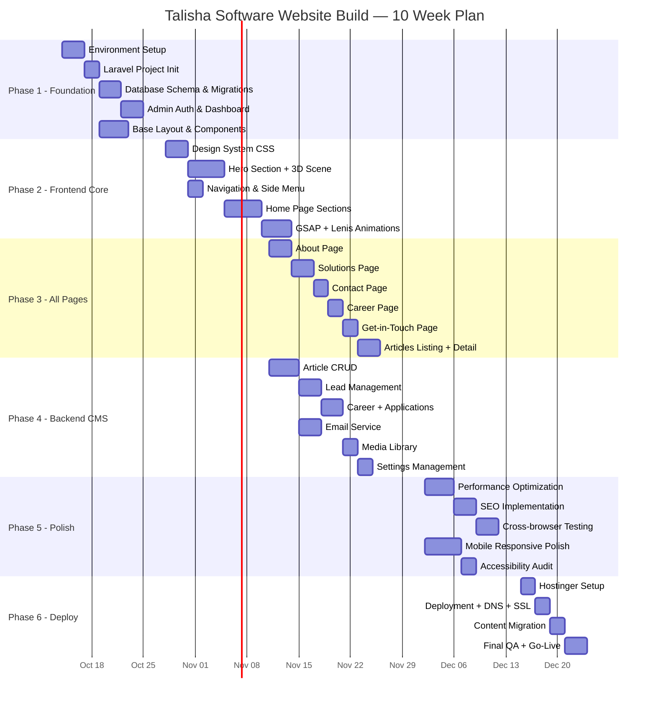

# 📅 Implementation Plan

## Talisha Software — World-Class Website Build Execution Plan

| Field | Detail |
|---|---|
| **Document Version** | 1.0 |
| **Date** | 2026-10-11 |
| **Total Duration** | 10 Weeks |
| **Stack** | PHP 8.2 · Laravel 11 · MySQL 8.0 · Three.js · GSAP · Hostinger |
| **Status** | Draft — Awaiting Approval |

---

## 1. Implementation Overview



---

## 2. Phase-by-Phase Breakdown

---

### 📦 PHASE 1: Foundation (Week 1–2)

> **Goal:** Set up development environment, initialize Laravel, create database schema, build admin authentication, and establish the base layout system.

#### Task 1.1 — Environment Setup
| Item | Action | Duration |
|---|---|---|
| Install PHP 8.2+, Composer, Node.js 20+ | Local dev machine | 1h |
| Install MySQL 8.0 (or XAMPP/Laragon) | Local dev machine | 30m |
| Set up Git repository | GitHub private repo | 15m |
| Create `.gitignore` for Laravel | Standard Laravel gitignore | 5m |
| Set up VS Code with PHP/Laravel extensions | Intelephense, Blade, etc. | 30m |

**Deliverable:** Working local dev environment

---

#### Task 1.2 — Laravel Project Initialization
| Item | Action |
|---|---|
| `composer create-project laravel/laravel talisha-website` | Init Laravel 11 |
| Configure `.env` with local DB credentials | Database connection |
| `npm install` | Install Node dependencies |
| Install Vite + Laravel Vite Plugin | Frontend build system |
| Install core packages: `alpinejs`, `gsap`, `three`, `lenis` | Frontend libs |
| Install Laravel Breeze for auth scaffolding | Admin auth |
| Configure `vite.config.js` with manual chunks | Code splitting |

```bash
# Commands
composer create-project laravel/laravel talisha-website
cd talisha-website
composer require laravel/breeze --dev
php artisan breeze:install blade
npm install three gsap lenis alpinejs @splinetool/runtime
npm run dev
```

**Deliverable:** Running Laravel project with Vite build system

---

#### Task 1.3 — Database Schema & Migrations
| Migration | Table | Priority |
|---|---|---|
| `create_users_table` | users (extend with role, avatar, etc.) | P0 |
| `create_article_categories_table` | article_categories | P0 |
| `create_articles_table` | articles | P0 |
| `create_tags_table` | tags | P1 |
| `create_article_tag_table` | article_tag (pivot) | P1 |
| `create_leads_table` | leads | P0 |
| `create_contact_submissions_table` | contact_submissions | P0 |
| `create_careers_table` | careers | P1 |
| `create_career_applications_table` | career_applications | P1 |
| `create_partners_table` | partners | P1 |
| `create_testimonials_table` | testimonials | P2 |
| `create_media_table` | media | P1 |
| `create_seo_metas_table` | seo_metas | P1 |
| `create_settings_table` | settings | P0 |
| `create_domain_configs_table` | domain_configs | P2 |
| `create_activity_logs_table` | activity_logs | P2 |
| `create_newsletter_subscribers_table` | newsletter_subscribers | P2 |
| `create_page_views_table` | page_views | P2 |

```bash
php artisan migrate
php artisan db:seed
```

**Deliverable:** All 17+ tables created with seeders running

---

#### Task 1.4 — Admin Authentication & Dashboard
| Item | Action |
|---|---|
| Customize Breeze login page | Dark theme, Talisha branding |
| Add admin middleware | Check `role` field for admin/super_admin |
| Create `AdminController` | Dashboard with stats widgets |
| Create admin layout (`admin.blade.php`) | Sidebar nav, header, content area |
| Register admin routes | Prefix `/admin`, middleware `auth`, `admin` |

**Deliverable:** Working admin login + dashboard showing stats

---

#### Task 1.5 — Base Layout & Blade Components
| Component | File |
|---|---|
| Main layout | `layouts/app.blade.php` |
| SEO head component | `components/seo-head.blade.php` |
| Navigation component | `components/navigation.blade.php` |
| Footer component | `components/footer.blade.php` |
| Hero component | `components/hero.blade.php` |
| Service card component | `components/service-card.blade.php` |
| Tech card component | `components/tech-card.blade.php` |
| Partner ticker component | `components/partner-ticker.blade.php` |
| Stat counter component | `components/stat-counter.blade.php` |
| Button component | `components/button.blade.php` |

**Deliverable:** Reusable Blade component library

---

### 🎨 PHASE 2: Frontend Core — Home Page (Week 3–5)

> **Goal:** Build the complete home page with world-class 3D animations, GSAP scroll effects, and all 9 sections from the current site.

#### Task 2.1 — Design System CSS (3 days)

| Deliverable | Details |
|---|---|
| CSS Custom Properties | All design tokens (colors, spacing, typography, shadows) |
| Modern CSS Reset | Box-sizing, margin reset, font smoothing |
| Typography System | Font imports, heading scale, responsive type |
| Grid System | Max-width containers, flex/grid utilities |
| Button Styles | All 4 variants (primary, outline, store, ghost) |
| Card Styles | Service cards, tech cards, impact cards |
| Form Styles | Inputs, textareas, selects, file upload |
| Animation Utilities | `.fade-up`, `.fade-in`, `.slide-left`, `.stagger` helper classes |

---

#### Task 2.2 — Hero Section + 3D Scene (5 days)

| Day | Task |
|---|---|
| **Day 1** | Set up Three.js renderer, scene, camera. Create particle system OR load Spline scene. |
| **Day 2** | Add mouse-follow parallax. Add scroll-depth parallax. Test on mobile (CSS fallback). |
| **Day 3** | Build hero overlay: logo, heading with GSAP SplitText animation, tagline |
| **Day 4** | Build search bar with glassmorphism. Add focus glow animation. Voice input icon. |
| **Day 5** | CTA buttons with ripple effects. Menu icon. Responsive adjustments. Performance test. |

**Performance Gates:**
- [ ] 3D scene renders at 60fps on desktop
- [ ] 3D scene renders at 30fps on mid-range mobile
- [ ] CSS fallback activates for low-end devices
- [ ] Hero LCP < 2.5 seconds

---

#### Task 2.3 — Navigation & Side Menu (2 days)

| Day | Task |
|---|---|
| **Day 1** | Side menu slide-in (from current code). Fix: sticky menu icon. Add page transition overlay. |
| **Day 2** | Mobile responsive. Touch-friendly. Overlay close. Active state highlighting. |

---

#### Task 2.4 — Home Page Sections (5 days)

| Day | Section Built |
|---|---|
| **Day 1** | Partner ticker (infinite CSS animation) + Stats counter (IntersectionObserver) |
| **Day 2** | Introduction section (parallax, fade-up text) + Mission statement |
| **Day 3** | AI Solutions showcase (tab switcher with video crossfade) |
| **Day 4** | Services grid (3 cards with hover lift + arrow anim) + Emerging Tech grid (4 bordered cards) |
| **Day 5** | Why Choose Us (split layout, orange box, numbered items) + Industry Impact (dual cards) + Footer CTA |

---

#### Task 2.5 — GSAP + Lenis Animation Integration (4 days)

| Day | Task |
|---|---|
| **Day 1** | Initialize Lenis smooth scroll. Set up GSAP ScrollTrigger. Register all scroll-triggered sections. |
| **Day 2** | Implement section-level animations: fade-up, stagger, parallax for Intro, Services, Tech sections |
| **Day 3** | Implement component-level animations: card entries, counter count-up, text reveals (SplitText) |
| **Day 4** | Polish timing/easing. Add `prefers-reduced-motion` support. Mobile animation adjustments. |

**Quality Gates:**
- [ ] Animations feel comparable to apple.com scroll reveals
- [ ] No jank on scroll (60fps)
- [ ] `prefers-reduced-motion` disables all animations
- [ ] Mobile animations are simpler but still premium

---

### 📄 PHASE 3: All Pages (Week 5–6)

> **Goal:** Build all remaining public pages with consistent design and animations.

#### Task 3.1 — About Page (3 days)
- Company story with scroll-driven timeline
- Founder/team section with photo cards
- Culture & values with animated icons
- Stats section reuse from home

#### Task 3.2 — Solutions Page (3 days)
- Deep-dive cards for each service (AI, Web3, IoT, Cloud, etc.)
- Interactive hover states with 3D tilt
- CTA buttons linking to Get-in-Touch

#### Task 3.3 — Contact Page (2 days)
- Contact form with validation (client + server)
- Google Maps embed
- Office location cards
- Social media links

#### Task 3.4 — Career Page (2 days)
- Company culture hero section
- Dynamic job listings from database
- Job detail view with Apply button
- Application form with resume upload

#### Task 3.5 — Get-in-Touch Page (2 days)
- Multi-step form wizard (3 steps)
- Service interest checkboxes
- Budget range and timeline selectors
- Thank you page after submission

#### Task 3.6 — Articles Section (3 days)
- Article listing page with grid cards
- Category filter sidebar
- Search functionality
- Single article page with rich content
- Related articles component
- Social share buttons

---

### ⚙️ PHASE 4: Backend CMS (Week 5–7, overlaps Phase 3)

> **Goal:** Build complete admin panel for content management.

#### Task 4.1 — Article CMS (4 days)

| Day | Task |
|---|---|
| **Day 1** | Article list view (DataTable with search, sort, filter) |
| **Day 2** | Create/Edit form (WYSIWYG editor — TinyMCE or similar, image upload) |
| **Day 3** | Category management (CRUD), tag management |
| **Day 4** | SEO fields integration, slug auto-generation, preview, publish/draft workflow |

#### Task 4.2 — Lead Management (3 days)

| Day | Task |
|---|---|
| **Day 1** | Lead list with status badges, filters (status, date range, service) |
| **Day 2** | Lead detail view with status update, admin notes |
| **Day 3** | CSV export, lead analytics (chart of leads per month) |

#### Task 4.3 — Career + Applications (3 days)

| Day | Task |
|---|---|
| **Day 1** | Career posting CRUD (create, edit, activate/deactivate) |
| **Day 2** | Application list with status pipeline (received → reviewing → shortlisted → ...) |
| **Day 3** | Resume download, application notes, email to candidate |

#### Task 4.4 — Email Service (3 days, parallel)

| Day | Task |
|---|---|
| **Day 1** | Set up Hostinger SMTP in Laravel. Create mail templates (Blade). |
| **Day 2** | Lead notification email (to admin). Lead confirmation email (to user). |
| **Day 3** | Contact form emails. Application confirmation. Queue all emails via database driver. |

#### Task 4.5 — Media Library (2 days)

- Upload interface with drag-and-drop
- Image preview, rename, delete
- Organize by collection (articles, careers, partners, general)
- File size validation, mime type check

#### Task 4.6 — Settings Management (2 days)

- Settings form grouped by tabs (General, Contact, Social, SEO, Email)
- Update all settings from admin panel
- Settings cache for performance

---

### ✨ PHASE 5: Polish & Optimization (Week 8–9)

> **Goal:** Performance optimization, SEO implementation, cross-browser testing, accessibility audit.

#### Task 5.1 — Performance Optimization (4 days)

| Day | Task |
|---|---|
| **Day 1** | Image optimization: convert all images to WebP/AVIF with `<picture>` fallbacks. Compress videos. |
| **Day 2** | Lazy loading: images, videos, 3D scene. Code splitting: separate Three.js, GSAP, vendor chunks. |
| **Day 3** | Server-side: route cache, config cache, view cache, eager loading. OPcache enable. |
| **Day 4** | Critical CSS inline. Font preloading. `dns-prefetch` for external resources. Lighthouse audit. |

**Targets:**
- [ ] Lighthouse Performance: >85 (mobile)
- [ ] LCP: <3 seconds
- [ ] CLS: <0.1
- [ ] Total page weight: <3MB (initial load)

---

#### Task 5.2 — SEO Implementation (3 days)

| Day | Task |
|---|---|
| **Day 1** | Implement `<x-seo-head>` component. Dynamic SEO from `seo_metas` table. Open Graph tags. Twitter cards. |
| **Day 2** | JSON-LD structured data (Organization, Article, BreadcrumbList). Auto-generate `sitemap.xml`. `robots.txt`. |
| **Day 3** | Canonical URLs. Heading hierarchy audit. Image `alt` text audit. Internal linking strategy. |

---

#### Task 5.3 — Cross-Browser Testing (3 days)

| Browser | Desktop | Mobile |
|---|---|---|
| Chrome 120+ | ✅ Test | ✅ Android Chrome |
| Firefox 120+ | ✅ Test | ✅ Firefox Mobile |
| Safari 17+ | ✅ Test | ✅ iOS Safari |
| Edge 120+ | ✅ Test | — |

**Test Checklist per browser:**
- [ ] 3D hero scene renders correctly
- [ ] All GSAP animations play smoothly
- [ ] Glassmorphism effects work (backdrop-filter)
- [ ] Forms submit correctly
- [ ] Video autoplay works (muted)
- [ ] Menu opens/closes properly
- [ ] No layout shifts

---

#### Task 5.4 — Mobile Responsive Polish (5 days)

| Day | Focus |
|---|---|
| **Day 1** | Test all pages on 360px, 375px, 390px, 412px (common phones) |
| **Day 2** | Test tablet: 768px, 1024px (landscape & portrait) |
| **Day 3** | Fix any layout breaks, text overflow, touch target issues |
| **Day 4** | Test 3D scene fallbacks on low-end devices |
| **Day 5** | Final sweep: notch phones (safe-area-inset), landscape mode |

---

#### Task 5.5 — Accessibility Audit (2 days)

| Day | Task |
|---|---|
| **Day 1** | Keyboard navigation test. Screen reader test (NVDA/VoiceOver). Focus management in modals. |
| **Day 2** | Color contrast audit (WCAG AA). `prefers-reduced-motion` test. `alt` text on all images. ARIA labels. |

---

### 🚀 PHASE 6: Deployment & Launch (Week 9–10)

> **Goal:** Deploy to Hostinger, configure DNS/SSL, migrate content, go live.

#### Task 6.1 — Hostinger Setup (2 days)

| Day | Task |
|---|---|
| **Day 1** | Purchase/configure Hostinger Business plan. Set PHP 8.2+. Create MySQL database. Enable SSH. |
| **Day 2** | Set up deployment structure (see TRD). Upload project files via Git. Configure `.env` for production. |

---

#### Task 6.2 — Deployment + DNS + SSL (2 days)

| Day | Task |
|---|---|
| **Day 1** | Run `deploy.sh` script. Test migrations. Verify all routes. Test email sending. |
| **Day 2** | Point DNS to Hostinger. Enable SSL (Let's Encrypt). Configure HTTPS redirects. Set up cron job. |

---

#### Task 6.3 — Content Migration (2 days)

| Day | Task |
|---|---|
| **Day 1** | Migrate all images, videos, 3D models to production. Upload partner logos. Seed settings. |
| **Day 2** | Create initial articles (from existing blog content). Set up admin user. Populate SEO meta for all pages. |

---

#### Task 6.4 — Final QA + Go-Live (3 days)

| Day | Task |
|---|---|
| **Day 1** | Full end-to-end test on production: all forms, all pages, all animations, all admin functions. |
| **Day 2** | Set up Google Analytics 4. Set up UptimeRobot monitoring. Verify email delivery. Test on real devices. |
| **Day 3** | **🎉 GO LIVE** — Switch DNS from old site. Announce launch. Monitor for 24 hours. |

---

## 3. Acceptance Criteria Checklist

### Visual Quality
- [ ] Website looks comparable to apple.com / nvidia.com / stripe.com
- [ ] 3D hero animation loads and runs smoothly
- [ ] All scroll animations trigger correctly
- [ ] Dark theme is cohesive and premium
- [ ] Typography is crisp and well-hierarched
- [ ] Card hover effects feel premium (lift, glow, tilt)
- [ ] Page transitions are smooth

### Functionality
- [ ] All 8 pages render correctly
- [ ] Side menu navigates to all pages
- [ ] Contact form submits and sends email
- [ ] Get-in-Touch form stores lead and sends email
- [ ] Career page shows active listings
- [ ] Job application uploads resume and sends notification
- [ ] Articles page lists published articles
- [ ] Article detail page renders rich content
- [ ] Partner ticker scrolls infinitely
- [ ] Stats counter animates on scroll

### Admin Panel
- [ ] Admin login works (email + password)
- [ ] Dashboard shows key metrics
- [ ] Articles: Create, Edit, Delete, Publish/Draft
- [ ] Leads: View, Update Status, Add Notes, Export CSV
- [ ] Careers: Create, Edit, Activate/Deactivate
- [ ] Applications: View, Update Status, Download Resume
- [ ] Settings: Update all site settings
- [ ] Media: Upload, View, Delete

### Performance
- [ ] Lighthouse Performance >85 (mobile)
- [ ] Lighthouse SEO >90
- [ ] LCP <3 seconds
- [ ] CLS <0.1
- [ ] No render-blocking resources
- [ ] Images optimized (WebP/AVIF)
- [ ] Videos compressed (<5MB each)

### SEO
- [ ] Unique `<title>` on every page
- [ ] Meta description on every page
- [ ] Open Graph tags present
- [ ] JSON-LD structured data (Organization)
- [ ] `sitemap.xml` auto-generated
- [ ] `robots.txt` configured
- [ ] Canonical URLs set
- [ ] Single `<h1>` per page

### Security
- [ ] HTTPS enforced
- [ ] CSRF tokens on all forms
- [ ] Rate limiting on form submissions
- [ ] File upload validation (type + size)
- [ ] SQL injection protected (Eloquent ORM)
- [ ] XSS protected (Blade escaping)
- [ ] Admin panel requires authentication
- [ ] `.env` not accessible via web

### Responsive
- [ ] Tested on 360px (small phone)
- [ ] Tested on 375px (iPhone SE)
- [ ] Tested on 390px (iPhone 14)
- [ ] Tested on 412px (Android)
- [ ] Tested on 768px (tablet portrait)
- [ ] Tested on 1024px (tablet landscape)
- [ ] Tested on 1440px (desktop)
- [ ] Tested on 1920px (full HD)

---

## 4. Risk Register

| # | Risk | Probability | Impact | Mitigation | Owner |
|---|---|---|---|---|---|
| R1 | 3D scene too heavy for mobile | High | High | Implement device detection + CSS fallback from Day 1 | Frontend Dev |
| R2 | Hostinger PHP version outdated | Low | High | Verify PHP 8.2 availability before purchase | DevOps |
| R3 | GSAP license issues | Low | Medium | Use GSAP's free tier (allows commercial use for non-competing products) | Lead Dev |
| R4 | Email delivery issues on Hostinger | Medium | Medium | Test SMTP early; have backup (Gmail SMTP / SendGrid free tier) | Backend Dev |
| R5 | Content not ready for launch | Medium | High | Start content preparation in Week 1; use placeholder content initially | PM |
| R6 | Browser compatibility for WebGL | Medium | Medium | Feature detection + graceful degradation | Frontend Dev |
| R7 | Scope creep | High | High | Strict adherence to PRD; any additions go to Phase 2 backlog | PM |

---

## 5. Post-Launch Roadmap (Phase 2+)

| Feature | Priority | Phase |
|---|---|---|
| Light theme toggle | P2 | Phase 2 (Month 2) |
| Multi-language support (Hindi, Bengali) | P2 | Phase 2 |
| Client portal (project tracking) | P3 | Phase 3 |
| AI chatbot integration | P2 | Phase 2 |
| Newsletter system | P2 | Phase 2 |
| Case study pages with results | P1 | Phase 2 |
| Google Play / App Store pages | P3 | Phase 3 |
| UAE market landing page | P2 | Phase 2 |
| Advanced analytics dashboard | P3 | Phase 3 |
| Blog commenting system | P3 | Phase 3 |

---

## 6. Team & Responsibilities

| Role | Responsibility | Phases |
|---|---|---|
| **Lead Developer** | Architecture, code reviews, Laravel backend, deployment | All |
| **Frontend Developer** | Three.js, GSAP, CSS, Blade templates, responsive | 2, 3, 5 |
| **Backend Developer** | Models, controllers, migrations, email, admin panel | 1, 4 |
| **UI/UX Designer** | Design tokens, component specs, responsive layouts, QA | 2, 3, 5 |
| **Project Manager** | Sprint planning, stakeholder updates, content coordination | All |
| **QA Tester** | Cross-browser testing, mobile testing, accessibility | 5, 6 |

---

## 7. Communication & Reporting

| Activity | Frequency | Format |
|---|---|---|
| Sprint Planning | Bi-weekly (start of each 2-week sprint) | Meeting + Jira/Trello board |
| Daily Standup | Daily (15 min) | Async text update or call |
| Sprint Demo | Bi-weekly (end of sprint) | Live demo to stakeholders |
| Progress Report | Weekly | Markdown document with screenshots |
| Blocker Escalation | As needed | Immediate Slack/call |

---

*Document maintained by Project Team. Last updated: 2026-10-11.*
