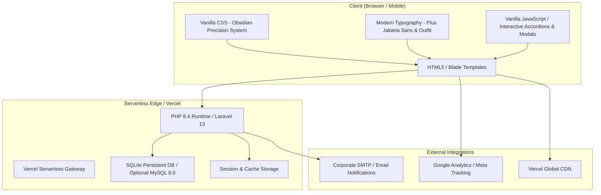
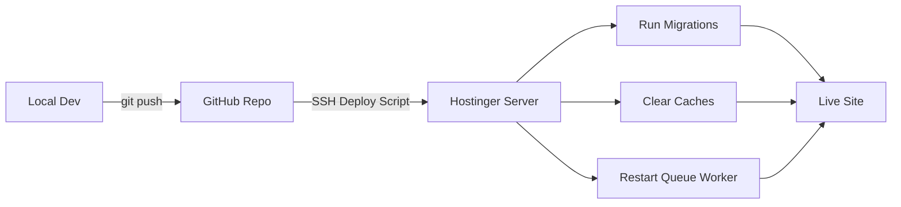

# 🔧 Technical Requirements Document (TRD)

## Talisha Software — World-Class Website Rebuild

| Field | Detail |
|---|---|
| **Document Version** | 2.0 (Production Stable) |
| **Date** | October 2026 |
| **Stack** | PHP 8.4 · Laravel 13 · SQLite / MySQL · Vercel Serverless |
| **Status** | Production Active |
| **Production URL** | [https://talisha-software.vercel.app](https://talisha-software.vercel.app) |

---

## 1. Technology Stack Overview



---

## 2. Backend Architecture

### 2.1 Framework: Laravel 11

| Component | Technology | Justification |
|---|---|---|
| **Framework** | Laravel 11.x | Best PHP framework; elegant syntax, robust ORM, built-in auth, queue system |
| **PHP Version** | 8.2+ | Required by Laravel 11; modern features (enums, fibers, readonly) |
| **Template Engine** | Blade | Native Laravel; fast compilation, component-based, layout inheritance |
| **ORM** | Eloquent | Active Record pattern; relationships, scopes, mutators |
| **Authentication** | Laravel Breeze / Fortify | Lightweight admin auth with session-based guards |
| **Authorization** | Gates & Policies | Role-based access for admin panel |
| **File Storage** | Laravel Filesystem (local) | Hostinger local disk; future S3 migration path |
| **Email** | Laravel Mail + Hostinger SMTP | Transactional emails for forms, notifications |
| **Cache** | File / Redis (if available) | Route cache, view cache, query cache |
| **Queue** | Database driver | Background jobs for emails, image processing |
| **Scheduler** | Laravel Task Scheduling | Sitemap generation, cache clearing, cleanup jobs |

### 2.2 Project Structure

```
talisha-website/
├── app/
│   ├── Http/
│   │   ├── Controllers/
│   │   │   ├── HomeController.php
│   │   │   ├── AboutController.php
│   │   │   ├── SolutionController.php
│   │   │   ├── ArticleController.php
│   │   │   ├── CareerController.php
│   │   │   ├── ContactController.php
│   │   │   ├── LeadController.php
│   │   │   └── Admin/
│   │   │       ├── DashboardController.php
│   │   │       ├── ArticleController.php
│   │   │       ├── LeadController.php
│   │   │       ├── CareerController.php
│   │   │       ├── MediaController.php
│   │   │       └── SettingController.php
│   │   ├── Middleware/
│   │   │   ├── AdminMiddleware.php
│   │   │   ├── SeoMiddleware.php
│   │   │   └── CacheResponseMiddleware.php
│   │   └── Requests/
│   │       ├── ContactFormRequest.php
│   │       ├── LeadFormRequest.php
│   │       ├── ArticleRequest.php
│   │       └── CareerApplicationRequest.php
│   ├── Models/
│   │   ├── User.php
│   │   ├── Article.php
│   │   ├── ArticleCategory.php
│   │   ├── Lead.php
│   │   ├── ContactSubmission.php
│   │   ├── Career.php
│   │   ├── CareerApplication.php
│   │   ├── Partner.php
│   │   ├── Testimonial.php
│   │   ├── Media.php
│   │   ├── SeoMeta.php
│   │   └── Setting.php
│   ├── Mail/
│   │   ├── LeadNotification.php
│   │   ├── ContactConfirmation.php
│   │   ├── ApplicationReceived.php
│   │   └── WelcomeEmail.php
│   ├── Services/
│   │   ├── SeoService.php
│   │   ├── MediaService.php
│   │   ├── AnalyticsService.php
│   │   └── DomainConfigService.php
│   └── Jobs/
│       ├── ProcessMediaUpload.php
│       ├── SendEmailNotification.php
│       └── GenerateSitemap.php
├── config/
│   ├── domains.php          # Multi-domain configuration
│   └── seo.php              # Default SEO settings
├── database/
│   ├── migrations/
│   ├── seeders/
│   └── factories/
├── public/
│   ├── index.php
│   ├── css/
│   │   ├── app.css           # Compiled styles
│   │   ├── animations.css    # GSAP/scroll animation helpers
│   │   └── components.css    # Reusable component styles
│   ├── js/
│   │   ├── app.js            # Main bundle
│   │   ├── three-scene.js    # Three.js hero scene
│   │   ├── gsap-init.js      # GSAP + ScrollTrigger + Lenis setup
│   │   ├── navigation.js     # Menu behavior
│   │   └── components/       # Modular JS components
│   ├── img/
│   ├── video/
│   ├── models/               # 3D model files (GLB/GLTF)
│   └── fonts/
├── resources/
│   ├── views/
│   │   ├── layouts/
│   │   │   ├── app.blade.php       # Main public layout
│   │   │   └── admin.blade.php     # Admin dashboard layout
│   │   ├── pages/
│   │   │   ├── home.blade.php
│   │   │   ├── about.blade.php
│   │   │   ├── solutions.blade.php
│   │   │   ├── contact.blade.php
│   │   │   ├── career.blade.php
│   │   │   └── get-in-touch.blade.php
│   │   ├── articles/
│   │   │   ├── index.blade.php
│   │   │   └── show.blade.php
│   │   ├── admin/
│   │   │   ├── dashboard.blade.php
│   │   │   ├── articles/
│   │   │   ├── leads/
│   │   │   ├── careers/
│   │   │   └── settings.blade.php
│   │   ├── components/
│   │   │   ├── hero.blade.php
│   │   │   ├── navigation.blade.php
│   │   │   ├── footer.blade.php
│   │   │   ├── service-card.blade.php
│   │   │   ├── tech-card.blade.php
│   │   │   ├── partner-ticker.blade.php
│   │   │   ├── stat-counter.blade.php
│   │   │   └── seo-head.blade.php
│   │   └── emails/
│   │       ├── lead-notification.blade.php
│   │       ├── contact-confirmation.blade.php
│   │       └── application-received.blade.php
│   └── css/
│       └── app.css           # Source CSS (compiled via Vite)
├── routes/
│   ├── web.php               # Public routes
│   ├── admin.php             # Admin routes (prefixed)
│   └── api.php               # API routes (if needed)
├── storage/
│   └── app/public/           # User uploads
├── .env
├── composer.json
├── package.json
├── vite.config.js
└── artisan
```

---

## 3. Database: MySQL 8.0

### 3.1 Configuration

```ini
# MySQL Performance Settings for Hostinger
innodb_buffer_pool_size = 256M
max_connections = 100
query_cache_type = 1
query_cache_size = 64M
character-set-server = utf8mb4
collation-server = utf8mb4_unicode_ci
```

### 3.2 Database Name & Credentials

```env
DB_CONNECTION=mysql
DB_HOST=localhost
DB_PORT=3306
DB_DATABASE=talisha_website
DB_USERNAME=talisha_user
DB_PASSWORD=<secure_password>
DB_CHARSET=utf8mb4
DB_COLLATION=utf8mb4_unicode_ci
```

### 3.3 Tables Overview

| Table | Purpose | Key Columns |
|---|---|---|
| `users` | Admin authentication | id, name, email, password, role, avatar |
| `articles` | Blog/article content | id, title, slug, body, excerpt, category_id, author_id, featured_image, seo_title, seo_description, status, published_at |
| `article_categories` | Article categorization | id, name, slug, description |
| `leads` | Get-in-touch form data | id, name, email, phone, company, service_interest, budget_range, timeline, message, status, source |
| `contact_submissions` | Contact form entries | id, name, email, phone, subject, message, is_read |
| `careers` | Job postings | id, title, slug, department, location, type, description, requirements, is_active |
| `career_applications` | Job applications | id, career_id, name, email, phone, resume_path, cover_letter, status |
| `partners` | Partner/client logos | id, name, logo_path, website_url, display_order, is_active |
| `testimonials` | Client testimonials | id, client_name, company, quote, avatar_path, rating, is_featured |
| `media` | Uploaded files | id, filename, path, mime_type, size, alt_text, uploaded_by |
| `seo_metas` | Page-level SEO data | id, page_slug, title, description, keywords, og_image, canonical_url |
| `settings` | Site-wide settings | id, key, value, group |
| `domain_configs` | Multi-domain config | id, domain, heading, logos_json, stats_json, is_active |
| `activity_logs` | Admin action tracking | id, user_id, action, model_type, model_id, changes, ip_address |

> [!NOTE]
> Full migration files and column definitions are detailed in [Backend_Schema.md](Backend_Schema.md).

---

## 4. Frontend Architecture

### 4.1 Build System: Vite

```javascript
// vite.config.js
import { defineConfig } from 'vite';
import laravel from 'laravel-vite-plugin';

export default defineConfig({
    plugins: [
        laravel({
            input: [
                'resources/css/app.css',
                'resources/js/app.js',
            ],
            refresh: true,
        }),
    ],
    build: {
        rollupOptions: {
            output: {
                manualChunks: {
                    'three': ['three'],
                    'gsap': ['gsap'],
                    'vendor': ['alpinejs', 'lenis'],
                },
            },
        },
    },
});
```

### 4.2 Frontend Dependencies

```json
{
  "dependencies": {
    "three": "^0.170.0",
    "gsap": "^3.12.0",
    "lenis": "^1.1.0",
    "alpinejs": "^3.14.0",
    "@splinetool/runtime": "^1.9.0"
  },
  "devDependencies": {
    "vite": "^6.0.0",
    "laravel-vite-plugin": "^1.0.0"
  }
}
```

### 4.3 JavaScript Architecture

```
resources/js/
├── app.js                    # Entry point — imports all modules
├── modules/
│   ├── smoothScroll.js       # Lenis smooth scroll initialization
│   ├── animations.js         # GSAP ScrollTrigger timeline configs
│   ├── heroScene.js          # Three.js / Spline hero 3D scene
│   ├── navigation.js         # Side menu toggle, sticky header
│   ├── partnerCarousel.js    # Infinite logo ticker
│   ├── videoSwitcher.js      # AI solutions tab/video interaction
│   ├── statCounter.js        # Intersection Observer count-up
│   ├── searchBar.js          # Hero search with voice input
│   ├── particles.js          # Background particle system
│   ├── cursorEffects.js      # Custom cursor with hover states
│   └── pageTransitions.js    # SPA-like page transition effects
└── utils/
    ├── domHelpers.js         # querySelector shortcuts
    ├── deviceDetect.js       # Mobile/desktop/GPU capability detection
    └── lazyLoader.js         # IntersectionObserver lazy loading
```

### 4.4 CSS Architecture

```
resources/css/
├── app.css                   # Entry — imports all partials
├── base/
│   ├── _reset.css            # Modern CSS reset
│   ├── _variables.css        # CSS custom properties (colors, spacing, fonts)
│   └── _typography.css       # Font declarations, heading scales
├── layout/
│   ├── _grid.css             # Responsive grid system
│   ├── _header.css           # Navigation, side menu
│   └── _footer.css           # Footer styles
├── components/
│   ├── _buttons.css          # All button variants (primary, outline, store, glow)
│   ├── _cards.css            # Service cards, tech cards, impact cards
│   ├── _forms.css            # Input fields, textareas, selects
│   ├── _carousel.css         # Partner logo ticker
│   ├── _hero.css             # Hero section (3D canvas, overlay text)
│   └── _modal.css            # Modal/overlay styles
├── pages/
│   ├── _home.css             # Home-specific layouts
│   ├── _about.css
│   ├── _solutions.css
│   ├── _articles.css
│   ├── _career.css
│   └── _contact.css
├── animations/
│   ├── _scroll-reveals.css   # Scroll-triggered animation classes
│   ├── _hover-effects.css    # Hover transitions, glow, tilt
│   ├── _loading.css          # Page loader animation
│   └── _particles.css        # Particle/dot backgrounds
└── utilities/
    ├── _responsive.css       # Breakpoint-specific overrides
    └── _helpers.css          # Utility classes (sr-only, clearfix, etc.)
```

---

## 5. API Routes

### 5.1 Public Routes (`routes/web.php`)

```php
// ============ PUBLIC PAGES ============
Route::get('/', [HomeController::class, 'index'])->name('home');
Route::get('/about', [AboutController::class, 'index'])->name('about');
Route::get('/solutions', [SolutionController::class, 'index'])->name('solutions');
Route::get('/articles', [ArticleController::class, 'index'])->name('articles.index');
Route::get('/articles/{slug}', [ArticleController::class, 'show'])->name('articles.show');
Route::get('/career', [CareerController::class, 'index'])->name('career');
Route::get('/contact', [ContactController::class, 'index'])->name('contact');
Route::get('/get-in-touch', [LeadController::class, 'create'])->name('lead.create');

// ============ FORM SUBMISSIONS ============
Route::post('/contact', [ContactController::class, 'store'])->name('contact.store');
Route::post('/get-in-touch', [LeadController::class, 'store'])->name('lead.store');
Route::post('/career/{career}/apply', [CareerController::class, 'apply'])->name('career.apply');

// ============ SITEMAP & FEEDS ============
Route::get('/sitemap.xml', [SeoController::class, 'sitemap'])->name('sitemap');
Route::get('/robots.txt', [SeoController::class, 'robots'])->name('robots');
```

### 5.2 Admin Routes (`routes/admin.php`)

```php
Route::prefix('admin')->middleware(['auth', 'admin'])->name('admin.')->group(function () {
    
    Route::get('/', [DashboardController::class, 'index'])->name('dashboard');
    
    // Articles CRUD
    Route::resource('articles', Admin\ArticleController::class);
    
    // Lead Management
    Route::get('leads', [Admin\LeadController::class, 'index'])->name('leads.index');
    Route::get('leads/{lead}', [Admin\LeadController::class, 'show'])->name('leads.show');
    Route::patch('leads/{lead}/status', [Admin\LeadController::class, 'updateStatus'])->name('leads.status');
    Route::delete('leads/{lead}', [Admin\LeadController::class, 'destroy'])->name('leads.destroy');
    Route::get('leads/export', [Admin\LeadController::class, 'export'])->name('leads.export');
    
    // Career Management
    Route::resource('careers', Admin\CareerController::class);
    Route::get('applications', [Admin\CareerController::class, 'applications'])->name('applications');
    Route::patch('applications/{application}/status', [Admin\CareerController::class, 'updateApplicationStatus']);
    
    // Media Library
    Route::post('media/upload', [Admin\MediaController::class, 'upload'])->name('media.upload');
    Route::delete('media/{media}', [Admin\MediaController::class, 'destroy'])->name('media.destroy');
    
    // Settings
    Route::get('settings', [Admin\SettingController::class, 'index'])->name('settings');
    Route::put('settings', [Admin\SettingController::class, 'update'])->name('settings.update');
    
    // Contact Submissions
    Route::get('contacts', [Admin\ContactController::class, 'index'])->name('contacts.index');
    Route::patch('contacts/{contact}/read', [Admin\ContactController::class, 'markRead'])->name('contacts.read');
});
```

---

## 6. Deployment: Hostinger

### 6.1 Server Requirements

| Requirement | Hostinger Plan |
|---|---|
| **Hosting Type** | Business Web Hosting or Cloud Hosting |
| **PHP Version** | 8.2+ (configure via hPanel) |
| **MySQL** | 8.0 (MariaDB 10.6+ also acceptable) |
| **Web Server** | LiteSpeed (Hostinger default) |
| **SSL** | Free SSL (Let's Encrypt via hPanel) |
| **Storage** | Minimum 50GB SSD |
| **Bandwidth** | Unlimited (Business plan) |
| **SSH Access** | Required for deployment |
| **Cron Jobs** | Required for Laravel scheduler |
| **Node.js** | Required for Vite build (build locally, deploy artifacts) |

### 6.2 Deployment Strategy



### 6.3 Deployment Script (`deploy.sh`)

```bash
#!/bin/bash
# Talisha Software — Deployment Script for Hostinger

set -e

echo "🚀 Starting deployment..."

# Navigate to project directory
cd ~/public_html

# Pull latest code
git pull origin main

# Install PHP dependencies (no dev packages in production)
composer install --no-dev --optimize-autoloader --no-interaction

# Run database migrations
php artisan migrate --force

# Clear and rebuild caches
php artisan config:cache
php artisan route:cache
php artisan view:cache
php artisan event:cache

# Link storage for public file access
php artisan storage:link

# Restart queue worker (if using supervisor)
php artisan queue:restart

# Set permissions
chmod -R 775 storage
chmod -R 775 bootstrap/cache

echo "✅ Deployment complete!"
```

### 6.4 Hostinger File Structure

```
~/
├── public_html/              # Document root (Laravel's public/ contents)
│   ├── index.php             # Laravel entry point
│   ├── .htaccess             # URL rewriting
│   ├── css/
│   ├── js/
│   ├── img/
│   ├── video/
│   ├── models/
│   └── storage -> ../storage/app/public
├── app/                      # Laravel app directory
├── bootstrap/
├── config/
├── database/
├── resources/
├── routes/
├── storage/
├── vendor/
├── .env                      # Environment configuration
├── artisan
└── composer.json
```

### 6.5 `.htaccess` Configuration

```apache
<IfModule mod_rewrite.c>
    RewriteEngine On
    RewriteBase /
    
    # Force HTTPS
    RewriteCond %{HTTPS} !=on
    RewriteRule ^ https://%{HTTP_HOST}%{REQUEST_URI} [L,R=301]
    
    # Remove www
    RewriteCond %{HTTP_HOST} ^www\.(.+)$ [NC]
    RewriteRule ^ https://%1%{REQUEST_URI} [R=301,L]
    
    # Laravel routing
    RewriteCond %{REQUEST_FILENAME} !-d
    RewriteCond %{REQUEST_FILENAME} !-f
    RewriteRule ^ index.php [L]
</IfModule>

# Compression
<IfModule mod_deflate.c>
    AddOutputFilterByType DEFLATE text/html text/css application/javascript application/json image/svg+xml
</IfModule>

# Browser caching
<IfModule mod_expires.c>
    ExpiresActive On
    ExpiresByType image/jpg "access plus 1 year"
    ExpiresByType image/jpeg "access plus 1 year"
    ExpiresByType image/png "access plus 1 year"
    ExpiresByType image/webp "access plus 1 year"
    ExpiresByType image/avif "access plus 1 year"
    ExpiresByType image/svg+xml "access plus 1 year"
    ExpiresByType video/mp4 "access plus 1 year"
    ExpiresByType text/css "access plus 1 month"
    ExpiresByType application/javascript "access plus 1 month"
    ExpiresByType font/woff2 "access plus 1 year"
</IfModule>

# Security headers
<IfModule mod_headers.c>
    Header always set X-Content-Type-Options "nosniff"
    Header always set X-Frame-Options "SAMEORIGIN"
    Header always set X-XSS-Protection "1; mode=block"
    Header always set Referrer-Policy "strict-origin-when-cross-origin"
    Header always set Permissions-Policy "camera=(), microphone=(), geolocation=()"
</IfModule>
```

### 6.6 Environment Variables (`.env`)

```env
APP_NAME="Talisha Software"
APP_ENV=production
APP_KEY=base64:GENERATE_NEW_KEY
APP_DEBUG=false
APP_URL=https://talishasoftware.tech

LOG_CHANNEL=daily
LOG_LEVEL=error

DB_CONNECTION=mysql
DB_HOST=localhost
DB_PORT=3306
DB_DATABASE=talisha_website
DB_USERNAME=talisha_user
DB_PASSWORD=<SECURE_PASSWORD>

CACHE_DRIVER=file
SESSION_DRIVER=file
QUEUE_CONNECTION=database

MAIL_MAILER=smtp
MAIL_HOST=smtp.hostinger.com
MAIL_PORT=465
MAIL_USERNAME=info@talishasoftware.tech
MAIL_PASSWORD=<EMAIL_PASSWORD>
MAIL_ENCRYPTION=ssl
MAIL_FROM_ADDRESS=info@talishasoftware.tech
MAIL_FROM_NAME="Talisha Software"

FILESYSTEM_DISK=local
```

### 6.7 Cron Job (Hostinger hPanel)

```
* * * * * cd /home/u123456/public_html && php artisan schedule:run >> /dev/null 2>&1
```

---

## 7. Performance Optimization

### 7.1 Server-Side

| Optimization | Implementation |
|---|---|
| **Route Caching** | `php artisan route:cache` |
| **Config Caching** | `php artisan config:cache` |
| **View Caching** | `php artisan view:cache` |
| **Eager Loading** | Prevent N+1 queries in Eloquent |
| **Query Caching** | Cache frequent queries (partners, settings) for 1 hour |
| **OPcache** | Enable PHP OPcache on Hostinger |
| **Gzip/Brotli** | LiteSpeed auto-compression |

### 7.2 Client-Side

| Optimization | Implementation |
|---|---|
| **Code Splitting** | Vite manual chunks (three.js, gsap, vendor) |
| **Lazy Loading** | `IntersectionObserver` for images, videos, 3D scenes |
| **Image Optimization** | WebP/AVIF with `<picture>` fallbacks |
| **Video Optimization** | Compressed MP4 (H.264, 720p max), poster images |
| **Font Loading** | `font-display: swap`, subset fonts, preload critical |
| **Critical CSS** | Inline above-fold CSS in `<head>` |
| **3D Optimization** | Load Three.js scene only when hero enters viewport; use compressed GLB models |
| **Prefetching** | `<link rel="prefetch">` for next-page resources |

---

## 8. Security

| Measure | Implementation |
|---|---|
| **CSRF Protection** | Laravel built-in `@csrf` tokens |
| **XSS Prevention** | Blade auto-escaping `{{ }}`, CSP headers |
| **SQL Injection** | Eloquent ORM + parameterized queries |
| **Authentication** | Bcrypt password hashing, session-based auth |
| **Rate Limiting** | Laravel throttle middleware on forms (10 req/min) |
| **File Upload Validation** | Mime type check, size limits, rename on upload |
| **HTTPS Enforcement** | `.htaccess` redirect + HSTS header |
| **Admin IP Restriction** | Optional: whitelist admin panel IPs |
| **Dependency Auditing** | `composer audit` in CI/CD pipeline |
| **Environment Security** | `.env` excluded from git, proper file permissions |

---

## 9. Testing Strategy

| Test Type | Tool | Coverage |
|---|---|---|
| **Unit Tests** | PHPUnit | Models, Services, Mail (>80% coverage target) |
| **Feature Tests** | PHPUnit | Routes, Controllers, Form Submissions |
| **Browser Tests** | Laravel Dusk (optional) | Critical user flows (form submit, navigation) |
| **Performance Tests** | Google Lighthouse, WebPageTest | LCP, FCP, CLS, TBT targets |
| **Security Tests** | OWASP ZAP, Manual pen test | XSS, CSRF, SQL injection vectors |
| **Cross-Browser** | BrowserStack / Manual | Chrome, Firefox, Safari, Edge |
| **Mobile** | Real devices + Chrome DevTools | iOS Safari, Android Chrome |

---

## 10. Monitoring & Maintenance

| Area | Tool/Approach |
|---|---|
| **Uptime Monitoring** | UptimeRobot (free tier) |
| **Error Tracking** | Laravel logs (`storage/logs/`) + email alerts |
| **Analytics** | Google Analytics 4 |
| **Performance** | Monthly Lighthouse audits |
| **Backups** | Hostinger auto-backups + manual DB export weekly |
| **Updates** | Monthly `composer update` for security patches |
| **SSL Renewal** | Auto-renewed by Hostinger Let's Encrypt |

---

*Document maintained by Engineering Team. Last updated: 2026-10-11.*
