# 🔄 Web Application Flow Document

## Talisha Software — User Journeys & System Flows

| Field | Detail |
|---|---|
| **Document Version** | 1.0 |
| **Date** | 2026-10-11 |
| **Status** | Draft |

---

## 1. High-Level Application Flow

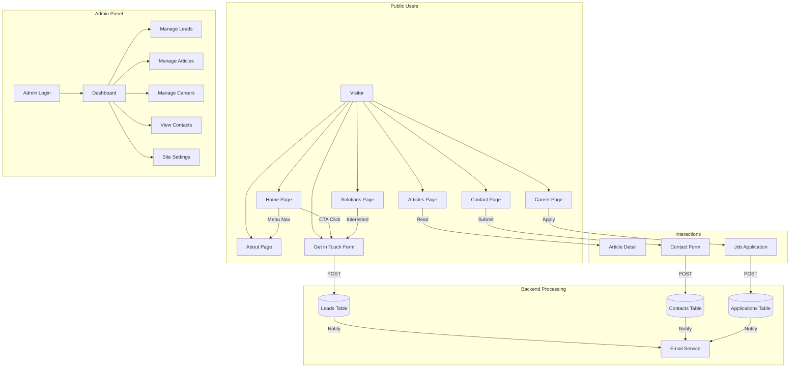

---

## 2. Page-by-Page User Flow

### 2.1 🏠 Home Page Flow

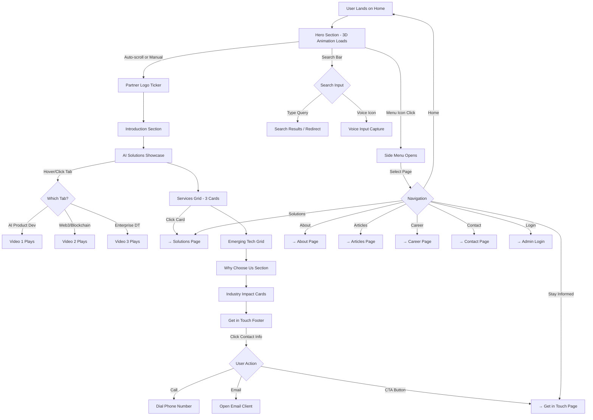

### 2.2 📝 Get in Touch (Lead Capture) Flow

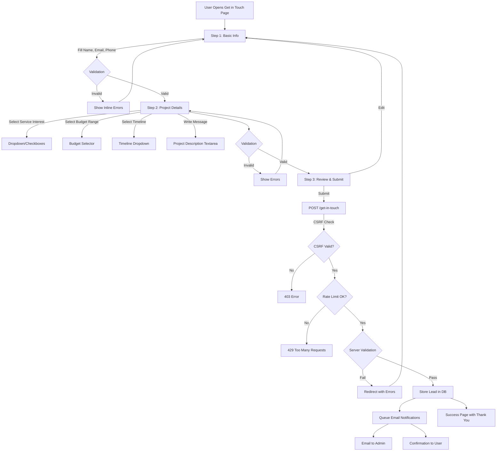

### 2.3 📞 Contact Form Flow

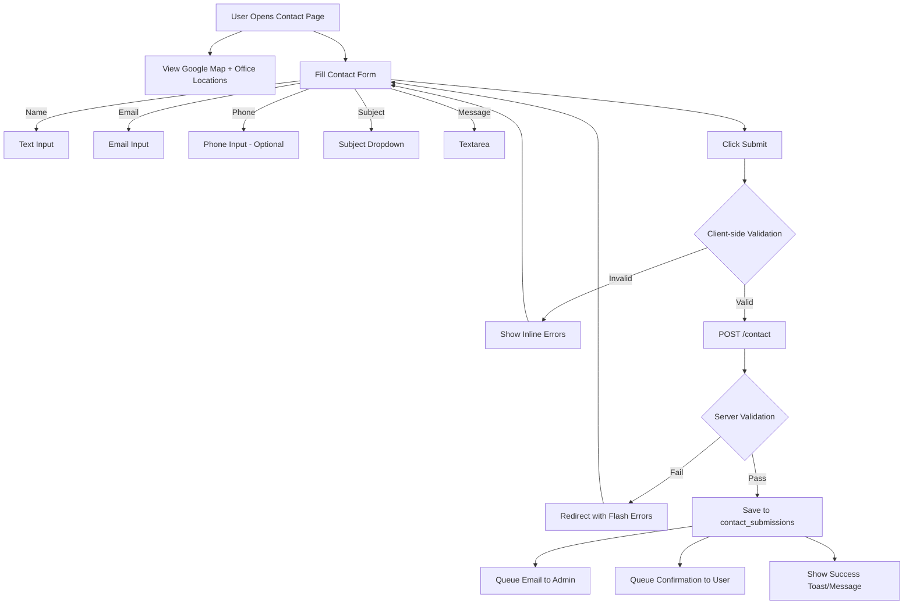

### 2.4 📰 Articles/Blog Flow

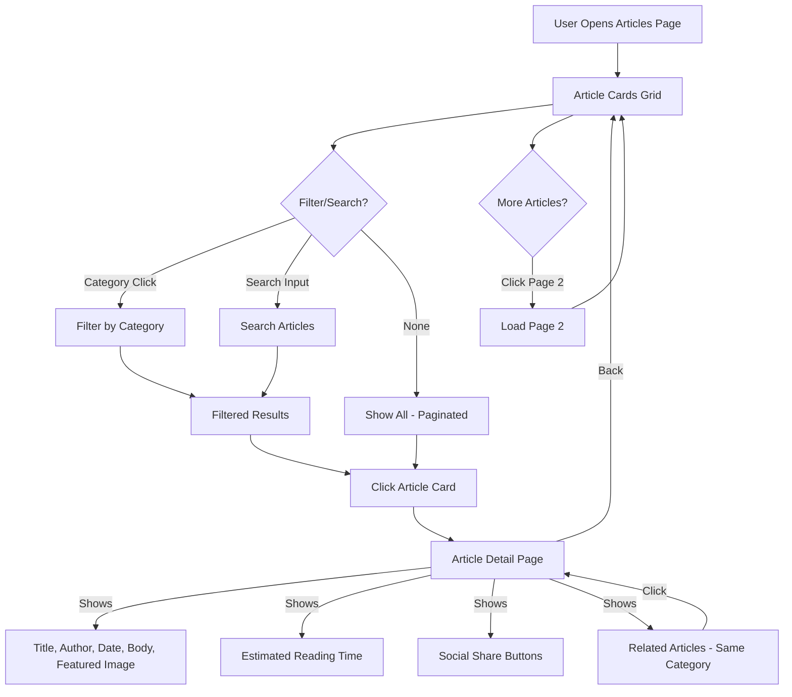

### 2.5 💼 Career Application Flow

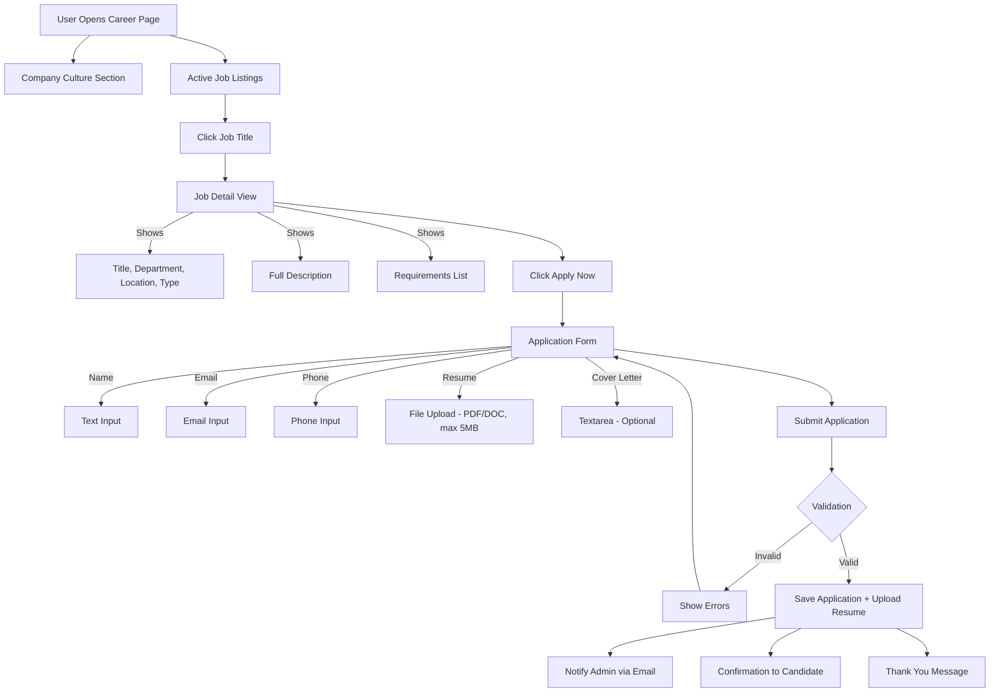

---

## 3. Admin Panel Flows

### 3.1 🔐 Admin Authentication Flow

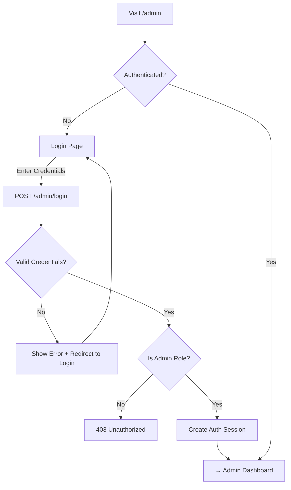

### 3.2 📊 Admin Dashboard Flow

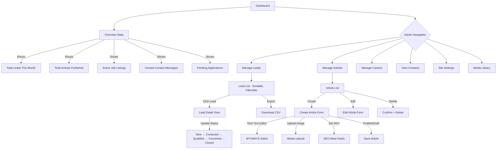

### 3.3 ✍️ Article CRUD Flow

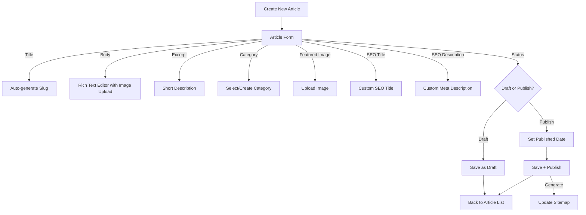

---

## 4. 3D Animation & Interaction Flow

### 4.1 Hero Section 3D Scene Lifecycle

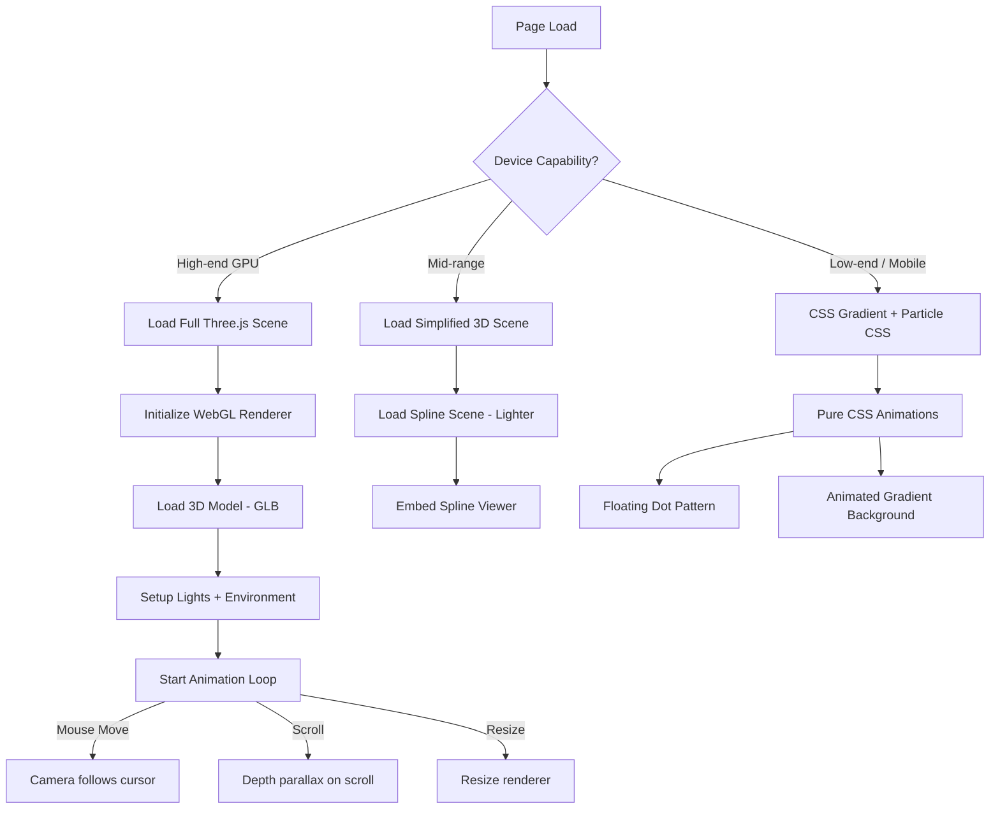

### 4.2 Scroll Animation Pipeline

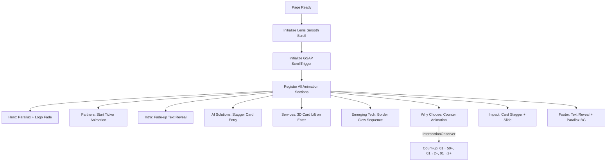

---

## 5. Email Notification Flow

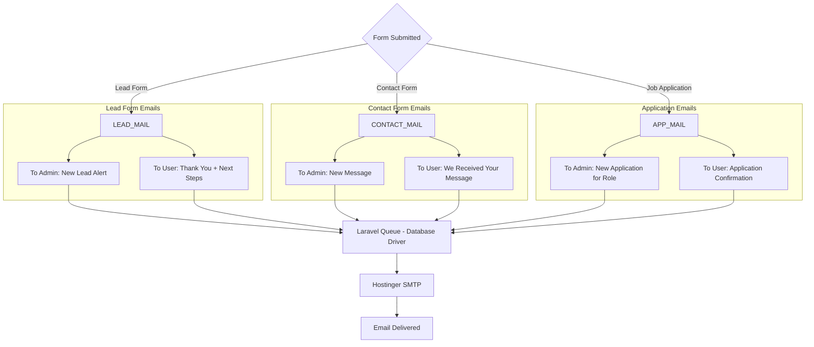

---

## 6. SEO & Analytics Flow

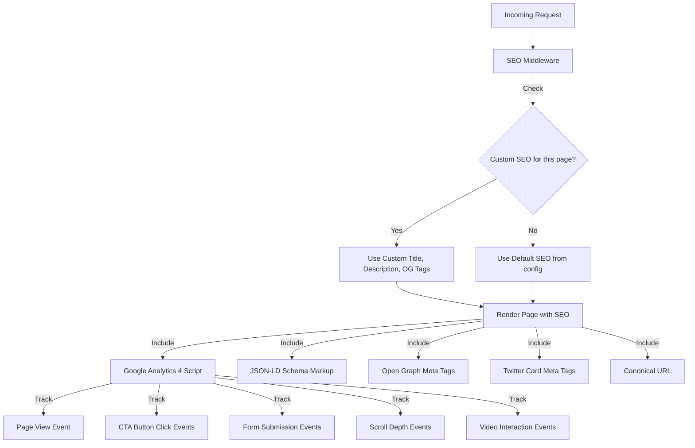

---

## 7. Multi-Domain Configuration Flow

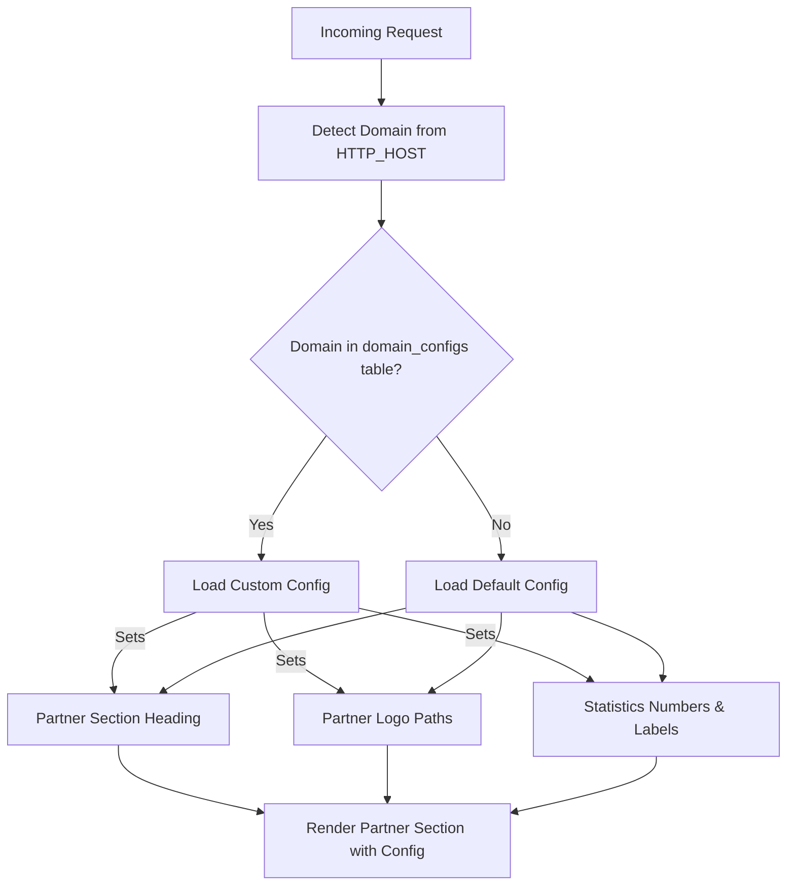

---

## 8. Error Handling Flow

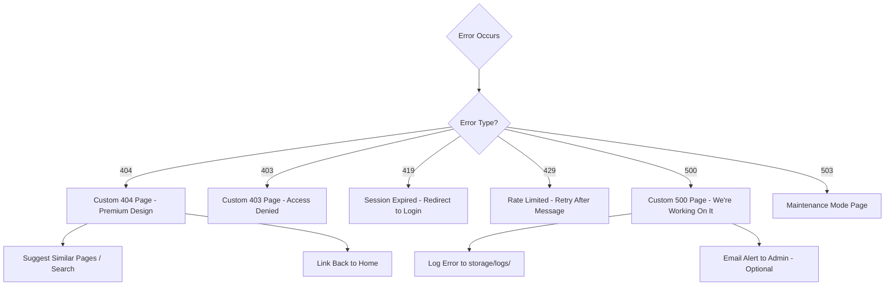

---

## 9. Performance & Caching Flow

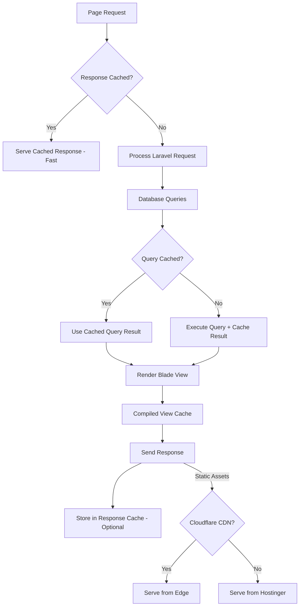

---

*Document maintained by Engineering Team. Last updated: 2026-10-11.*
